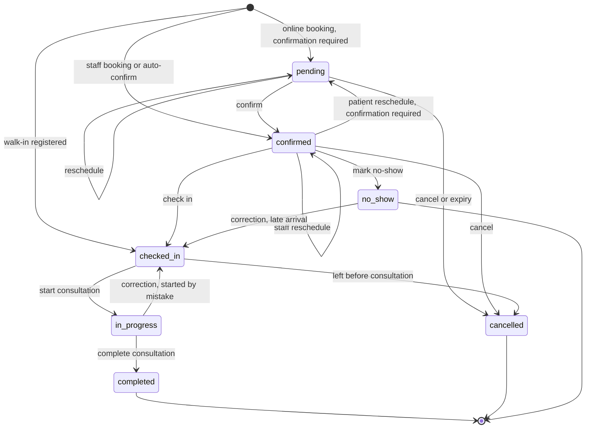
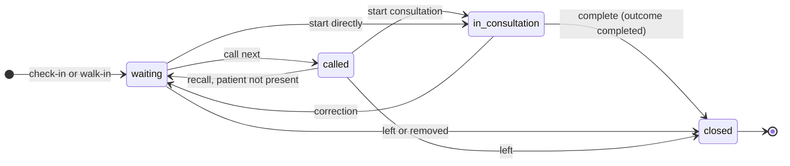
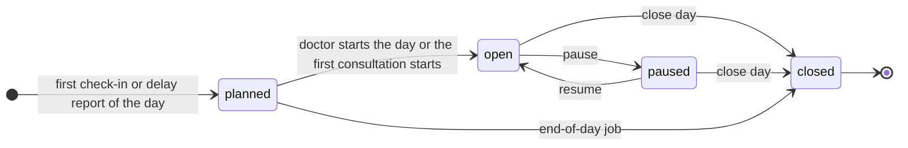
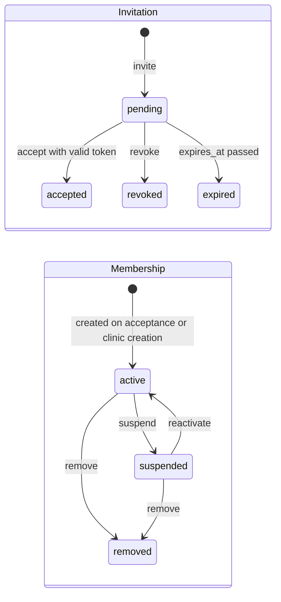
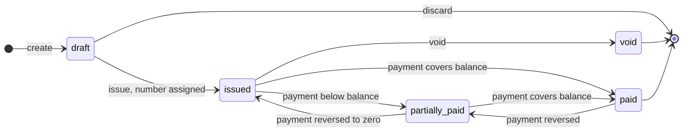
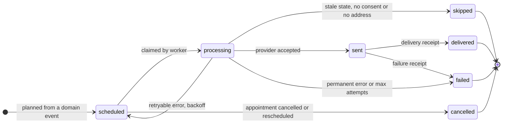
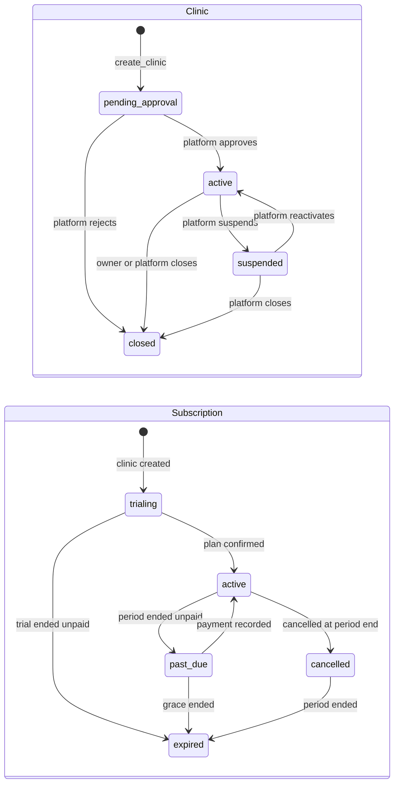

# SmartCabin — Business Rules and State Machines

| | |
| --- | --- |
| Status | **Draft for review** (system modeling phase) |
| Date | 2026-11-10 |
| Related | [DOMAIN_MODEL.md](DOMAIN_MODEL.md) · [RBAC_PERMISSION_MATRIX.md](RBAC_PERMISSION_MATRIX.md) · [USER_WORKFLOWS.md](USER_WORKFLOWS.md) |

Rule ids (`BR-x-nn`) are stable: tests and code comments refer to them. **Enforced at** names where the rule is guaranteed:
- **DB** means a constraint, trigger or command function, which holds even if someone calls the API directly.
- **App** means an application service, used where the rule needs data that only the application has.

---

## 1. Tenancy and access

| ID | Rule | Enforced at |
| --- | --- | --- |
| BR-T-01 | Every tenant-owned row belongs to exactly one clinic. Its `clinic_id` never changes after insert | DB (trigger) |
| BR-T-02 | Rows that reference each other belong to the same clinic | DB (composite FKs) |
| BR-T-03 | Access requires an **active** membership in an **active** or `pending_approval` clinic. A suspended clinic is read-only, a closed clinic allows export only | DB (RLS helpers) |
| BR-T-04 | An active clinic always has at least one active `clinic_owner` | DB (deferred constraint trigger) |
| BR-T-05 | Members cannot change their own role or status. Admins cannot grant `clinic_owner` or `clinic_admin` | DB (command) |
| BR-T-06 | Owners, admins, accountants and platform admins must use an `aal2` (MFA) session | DB (RLS/command) + App |
| BR-T-07 | Online booking can only be enabled while the clinic is `active` and has at least one active doctor with an online-bookable service | DB (trigger) |
| BR-T-08 | Plan limits (`max_doctors`, `max_staff`, `monthly_sms_quota`) are checked inside the commands that would exceed them | DB (command) |

---

## 2. Appointment lifecycle

### 2.1 Transition table

| # | From → To | Command | Who (permission) | Guards | Side effects (same transaction) |
| --- | --- | --- | --- | --- | --- |
| A1 | ∅ → `pending` | `book_appointment` (online) | Patient account | Booking rules BR-B-01…10; `auto_confirm_online = false` | History, `appointment.booked` event |
| A2 | ∅ → `confirmed` | `book_appointment` | Staff `appointments.book`, or patient when auto-confirm is on | Booking rules | History, `appointment.confirmed` event |
| A3 | ∅ → `checked_in` | `register_walk_in` | `queue.check_in` | Doctor session not closed; today in clinic time | Queue entry, ticket, estimate recomputation, history, events |
| A4 | `pending` → `confirmed` | `confirm_appointment` | `appointments.confirm` | Slot still valid (exclusion constraint) | `confirmed_at`, history, `appointment.confirmed` |
| A5 | `pending`/`confirmed` → same or `pending` | `reschedule_appointment` | Staff `appointments.reschedule`; patient before cutoff | Booking rules for the new slot. A patient reschedule returns to `pending` if the clinic requires confirmation | Times updated, `version++`, history (`rescheduled`, old and new start), `appointment.rescheduled` |
| A6 | `pending`/`confirmed` → `cancelled` | `cancel_appointment` | Staff `appointments.cancel`; patient for own, before `patient_cancel_cutoff_hours` | Reason required | Cancellation fields, history, `appointment.cancelled` (pending reminders cancelled) |
| A7 | `pending` → `cancelled` | job `expire_pending_appointments` | System | `starts_at` passed without confirmation | Reason `not_confirmed_in_time`, actor `system` |
| A8 | `confirmed` → `checked_in` | `check_in_appointment` | `queue.check_in` | Appointment's local date = today; doctor session not closed | Queue entry (§3), `checked_in_at`, history, broadcast |
| A9 | `confirmed` → `no_show` | `mark_no_show` | `appointments.mark_no_show` | `now() > starts_at + checkin_grace_minutes` | `no_show_at`, history, `appointment.no_show` |
| A10 | `checked_in` → `in_progress` | `start_consultation` | `queue.start` (doctor: own) | No other entry `in_consultation` for this doctor session | Queue entry `in_consultation`, `started_at`, recomputation |
| A11 | `checked_in` → `cancelled` | `mark_left` | `queue.mark_left` | — | Reason `left_before_consultation`, queue entry closed (`left`) |
| A12 | `in_progress` → `completed` | `complete_consultation` | `queue.complete` (doctor: own) | — | `completed_at`, queue entry closed (`completed`), recomputation, `consultation.completed` |
| A13 | `in_progress` → `checked_in` | `correct_appointment_status` | `appointments.correct_status` | Within 15 min of `started_at`; reason required | Queue entry back to `waiting` (keeps its sort key), history, audit |
| A14 | `no_show` → `checked_in` | `correct_appointment_status` | `appointments.correct_status` | Same local day; doctor session not closed; reason required | New queue entry ranked by arrival time (late-arrival rule), history, audit |

Every other transition is rejected with `APPT_INVALID_TRANSITION`. `completed`, `cancelled` and `no_show` are final except for corrections A13 and A14. No-show is **not** marked automatically in the MVP. Instead, the end-of-day screen lists confirmed appointments that were never checked in (decision MD-09).

### 2.2 Booking rules

These run inside `book_appointment` and `reschedule_appointment`, in one transaction.

| ID | Rule |
| --- | --- |
| BR-B-01 | The clinic is `active` (online bookings also need `online_booking_enabled`) |
| BR-B-02 | The doctor is `active`, and for online bookings `online_bookable` |
| BR-B-03 | The doctor offers the service: the `doctor_services` row is active (and online-bookable for online bookings). Also guaranteed structurally by the composite FK |
| BR-B-04 | Duration = effective service duration, **computed on the server**. Any client-sent `ends_at` is ignored |
| BR-B-05 | The interval lies entirely inside one availability window of the schedule that applies on that local date (an override beats the regular schedule) |
| BR-B-06 | The interval does not intersect the doctor's time off or a clinic closure |
| BR-B-07 | Online bookings start at least `min_lead_minutes` from now and at most `max_horizon_days` ahead |
| BR-B-08 | No overlap with the doctor's active appointments. The exclusion constraint is the final arbiter under concurrency, and its error maps to `SLOT_UNAVAILABLE`. Staff with `appointments.overbook` may set `is_overbooked` with a reason, which bypasses this rule only |
| BR-B-09 | A patient account may hold at most `max_active_online_bookings` future active online appointments **per clinic** |
| BR-B-10 | The same `idempotency_key` in the same clinic returns the existing appointment instead of creating a second one |
| BR-B-11 | `price_mad` is copied from the effective price at booking. Later price changes do not affect it |
| BR-B-12 | Availability and time-off edits never move or cancel existing appointments. The command returns the conflicts for staff to handle |

### 2.3 Time rules

| ID | Rule |
| --- | --- |
| BR-TZ-01 | Instants are stored as `timestamptz` (UTC). Schedules are stored as local wall-clock time with the clinic's `timezone` |
| BR-TZ-02 | A local date and time is converted to an instant **for that specific date** using the time-zone database, never with a fixed offset. This covers Morocco's UTC+1 / UTC+0 Ramadan switch |
| BR-TZ-03 | A window that falls in a non-existent or repeated local hour at a switch is clipped to the valid instants. Property tests cover the switch dates |
| BR-TZ-04 | "Today" always means today in the clinic's time zone, never the server's or the browser's |

---

## 3. Queue entry lifecycle (SmartFlow)

**Mapping to the appointment status.** The appointment status is authoritative. The two always change in the same command, and a constraint trigger rejects any mismatch.

| Queue state | Appointment status |
| --- | --- |
| `waiting`, `called` | `checked_in` |
| `in_consultation` | `in_progress` |
| `closed` + `completed` | `completed` |
| `closed` + `left` | `cancelled` (reason `left_before_consultation`) |
| `closed` + `cancelled` | `cancelled` (checked in by mistake, duplicate) |

### 3.1 Queue rules

| ID | Rule | Enforced at |
| --- | --- | --- |
| BR-Q-01 | Queue entries exist only for checked-in appointments. Walk-ins first create an appointment (`source = walk_in`) | DB |
| BR-Q-02 | One session per doctor per local day. Ticket numbers are gapless per session (counter row locked) | DB |
| BR-Q-03 | At most one entry `in_consultation` per session | DB (partial unique index) |
| BR-Q-04 | **Ordering policy v1**: ascending `sort_key`. When an entry is created, `sort_key` = epoch of the *anchor time*: • **scheduled patient checked in by `starts_at + checkin_grace_minutes`**: anchor = `starts_at` • **late scheduled patient or walk-in**: anchor = `checked_in_at` Ties are broken by ticket number | DB (command) |
| BR-Q-05 | Priority (level 1) places an entry ahead of every level-0 entry, keeping FIFO among priority entries. It is set **only by an authorized human with a reason**. The system never assigns priority from patient data (no automated triage) | DB (command + check) |
| BR-Q-06 | Manual reorder (`move_before`) sets `sort_key` between the two neighbors. It requires `queue.reorder` and is logged with actor and reason | DB |
| BR-Q-07 | `call_next` takes the waiting entry with the lowest (priority desc, `sort_key`). A recalled entry keeps its `sort_key` | DB |
| BR-Q-08 | Every queue change increments `doctor_sessions.queue_version` and broadcasts a hint with the new version | DB (trigger) |
| BR-Q-09 | Queue screens and broadcasts never contain patient names, reasons or services. Display screens show ticket numbers only | DB + App |

### 3.2 Wait-time estimation v1 (deterministic)

The estimate is recomputed inside every command that changes the queue, and every minute for open sessions whose current consultation has run past its expected end.

1. **Expected duration of an entry** =
   - `median_minutes` from `consultation_duration_stats` for (doctor, service) **if `sample_size ≥ 20`**;
   - otherwise the effective service duration.
2. **Doctor available at**:
   - if a consultation is in progress: `max(now, consultation_started_at + its expected duration)`;
   - if the session is open and idle: `now`;
   - if the doctor has not started: `max(now, first window start of the day + announced_delay_minutes)`;
   - if the session is paused: `now + announced_delay_minutes`.
3. Walk the waiting and called entries in queue order, accumulating expected durations. `estimated_start_at` of each entry = the doctor's available time + the sum of the expected durations ahead of it.
4. **Displayed as a range**: low = estimate − 20 %, high = estimate + `max(20 %, p80 − median)`, rounded to 5 minutes. It is labeled as an estimate in both languages, never as a promise.
5. **Turn approaching**: when an entry's position becomes ≤ `turn_approaching_positions`, a `queue.turn_approaching` event is emitted once (idempotency key = entry id).

| ID | Rule |
| --- | --- |
| BR-Q-10 | Estimates are predictions. They never block or reorder anything |
| BR-Q-11 | A reported delay (`report_doctor_delay`) shifts estimates and emits `session.delay_reported`. Messages go to waiting patients and to confirmed patients booked within the next 3 hours |

### 3.3 Doctor session lifecycle

Closing a session with entries still waiting is allowed only with `queue.manage_session`. The command returns the open entries for staff to resolve (mark left, or move to another doctor by cancelling and rebooking).

---

## 4. Membership and invitation lifecycle

| ID | Rule |
| --- | --- |
| BR-M-01 | Accepting an invitation requires a signed-in account whose verified email equals the invited email (case-insensitive) |
| BR-M-02 | Tokens are random (≥ 128 bits), stored hashed, single-use, expire after 7 days, and travel in the URL fragment |
| BR-M-03 | Removing a member who is linked to a `doctors` row keeps the doctor record but unlinks login access. Their future appointments are listed for reassignment |
| BR-M-04 | Last-owner protection: suspending, removing or demoting the last active owner is rejected (`LAST_OWNER`) |

---

## 5. Invoice and payment lifecycle

| ID | Rule |
| --- | --- |
| BR-F-01 | The number is assigned **at issue** from `clinic_counters` (`invoice:<fiscal_year>`) in the same transaction. Issued numbers are gapless and never reused. Drafts have no number |
| BR-F-02 | An issued invoice is immutable: items, amounts, patient, the `bill_to_name` and `clinic_snapshot` snapshots |
| BR-F-03 | Status follows payments: Σ recorded payments = 0 → `issued`; between 0 and the total → `partially_paid`; = total → `paid`. Recomputed by trigger with the invoice row locked |
| BR-F-04 | A payment requires amount > 0 and ≤ remaining balance (no overpayment in the MVP; change is handled at the desk) |
| BR-F-05 | Payments are never deleted. A correction is a reversal with a reason (`payments.reverse`), and the invoice status is then recomputed |
| BR-F-06 | Only an invoice with no recorded (un-reversed) payments can be voided. Voiding keeps its number (no gap) and requires a reason |
| BR-F-07 | Every payment gets a gapless receipt number (`receipt:<year>`) at recording |
| BR-F-08 | Amounts are `numeric(12,2)` MAD, never floating point. Rounding is half-up at line level |
| BR-F-09 | Credit notes, VAT treatment, required legal mentions (ICE, IF, etc.) and fiscal-year rules are **pending validation by an accountant** before commercial use |

---

## 6. Notification lifecycle

| ID | Rule |
| --- | --- |
| BR-N-01 | Every notification has a unique idempotency key derived from (event, entity, scheduled time, channel, offset). Re-planning the same event creates nothing new |
| BR-N-02 | **Immediately before sending**, the worker re-reads the appointment or queue entry. A reminder is skipped unless the appointment is still `confirmed` with the same `starts_at`. A turn-approaching message is skipped unless the entry is still `waiting` |
| BR-N-03 | Rescheduling or cancelling cancels every `scheduled` notification for that appointment and plans new ones |
| BR-N-04 | Messages are sent only on channels with granted consent (`patient_consents`), in the patient's `preferred_locale`, to the address read at send time |
| BR-N-05 | SMS and WhatsApp content: clinic display name or neutral sender, date, time, ticket number and an opaque, expiring link only. **Never** a service, specialty, reason or other clinical detail |
| BR-N-06 | Retries: exponential backoff (1, 5, 15, 60 min), at most 5 attempts. A permanent provider error fails immediately |
| BR-N-07 | Reminders are not sent between 21:00 and 08:00 clinic time. They are moved to 08:00, unless that is after the appointment, in which case they are skipped |
| BR-N-08 | SMS sent count against the plan's `monthly_sms_quota`. Over quota: email if consented, otherwise skipped with reason `quota_exceeded` |
| BR-N-09 | Default reminder offsets: 24 h before. They are configurable per clinic (`reminder_offsets_minutes`) |

---

## 7. Clinic and subscription lifecycles

| ID | Rule |
| --- | --- |
| BR-P-01 | Expired subscription: the clinic becomes read-only (no new bookings, data still accessible and exportable). It is not suspended automatically: the platform decides |
| BR-P-02 | A clinic in `pending_approval` can configure services, doctors and schedules but cannot take online bookings or send patient messages |
| BR-P-03 | Closing a clinic starts the export-then-retention procedure. Purge happens only after the retention period (TBD, counsel) |

---

## 8. KPI definitions (Analytics)

All KPIs are computed from records, scoped by clinic and permission, per **local** date in the clinic's time zone. "Day D" = appointments whose `starts_at` falls on local date D.

| KPI | Definition |
| --- | --- |
| K1 Daily appointments | Count of appointments for day D, all statuses, broken down by final status and source |
| K2 Completed consultations | Count with status `completed` |
| K3 Cancelled appointments | Count with status `cancelled`, split by actor (patient, clinic, system). `left_before_consultation` is shown separately |
| K4 No-show rate | `no_show / (completed + no_show + left_before_consultation)` among `source ≠ walk_in`. Undefined if the denominator is 0 |
| K5 Average waiting time | Mean and median of `consultation_started_at − anchor`, where anchor = `max(checked_in_at, starts_at)` for scheduled patients and `checked_in_at` for walk-ins. Completed entries only |
| K6 Doctor utilization | `booked minutes / available minutes`, where booked = sum of durations of non-cancelled appointments and available = schedule windows minus time off and closures. A second "actual" figure uses real consultation minutes |
| K7 Daily revenue | **Collected**: Σ recorded payments with `paid_at` on day D minus reversals made on day D. **Invoiced**: Σ totals of invoices issued on D. Billing owns these definitions |
| K8 Distribution by service | Count of completed appointments per service (and share %) |

Doctors see their own K1–K6 and K8. Owners and admins see everything. Accountants see K7. Platform admins see only clinic-level aggregate counts, never per-patient data.

---

## 9. Data-protection rules

| ID | Rule |
| --- | --- |
| BR-D-01 | Only administrative patient data is collected in the MVP: no diagnoses, notes, prescriptions or documents. `patient_reason` is optional, at most 200 characters and visible to staff only (not accountants) |
| BR-D-02 | Patient portal accounts see only the records explicitly linked to them (`patient_accounts`). Phone-number matching never links records automatically |
| BR-D-03 | Opening a patient's detail view writes `patient.viewed` to `audit_logs` |
| BR-D-04 | Domain events, realtime payloads, logs and error reports carry identifiers only |
| BR-D-05 | No real patient data in any environment until the CNDP clearance is recorded (audit R4) |
