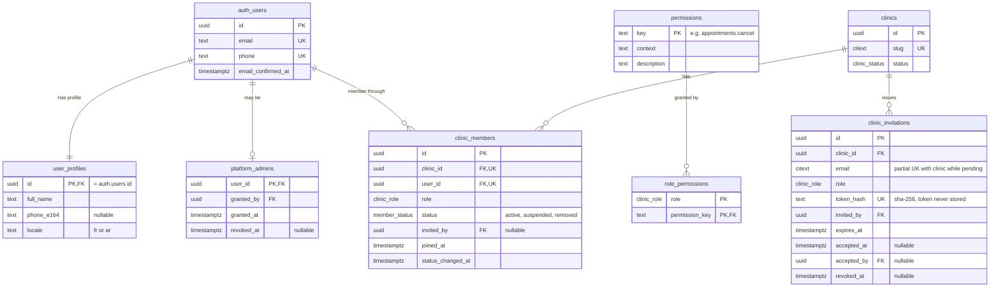
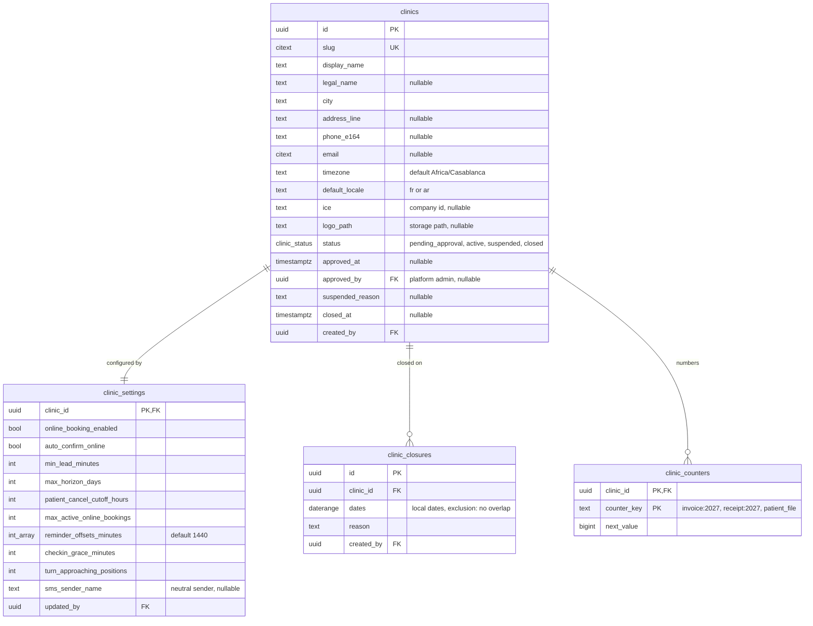
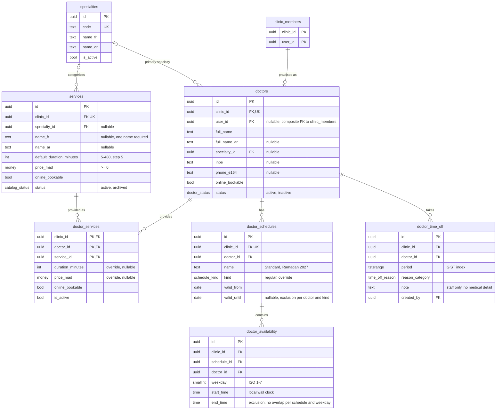
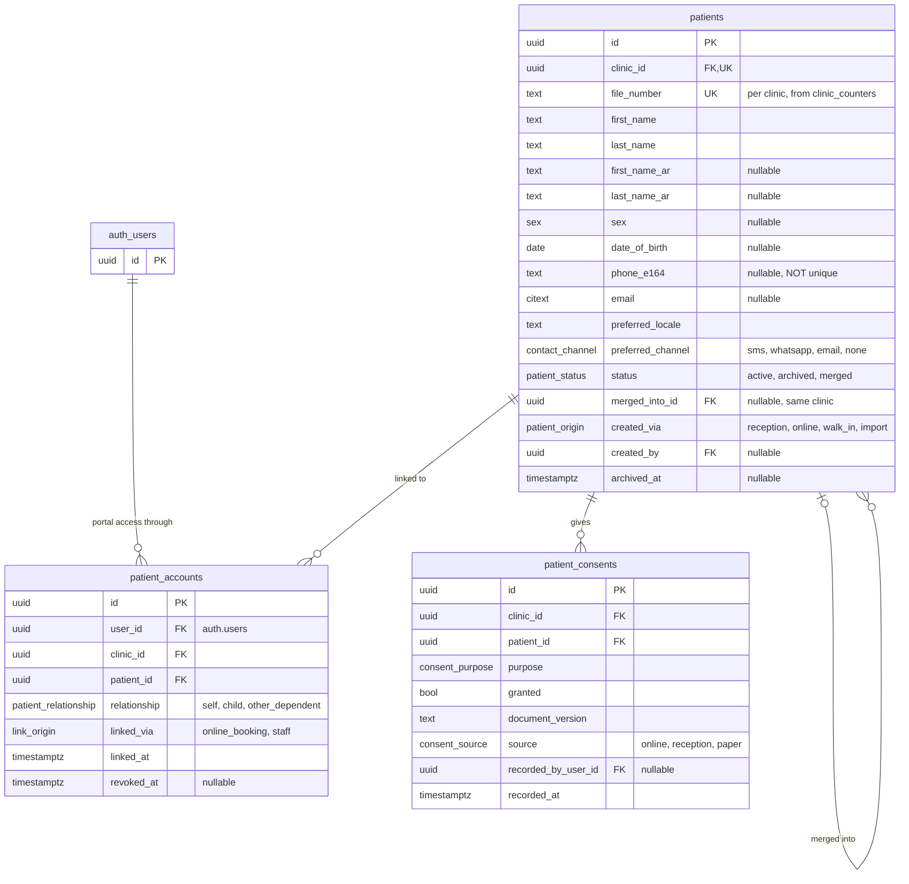
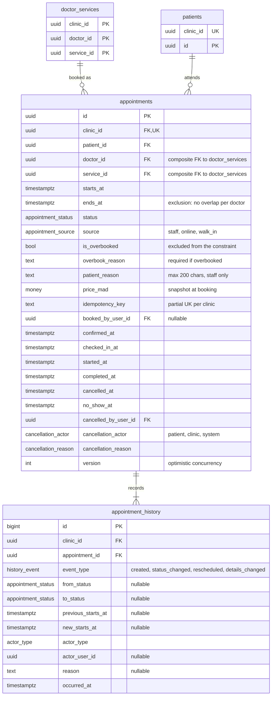
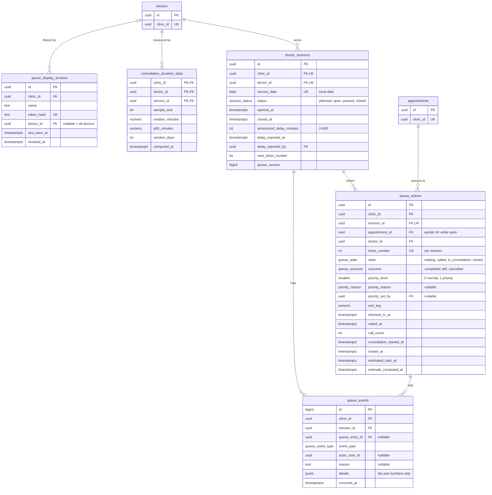
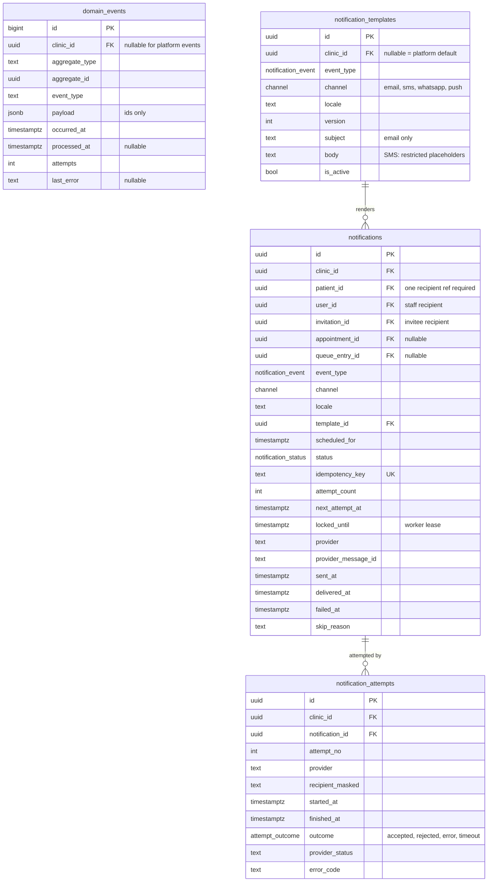
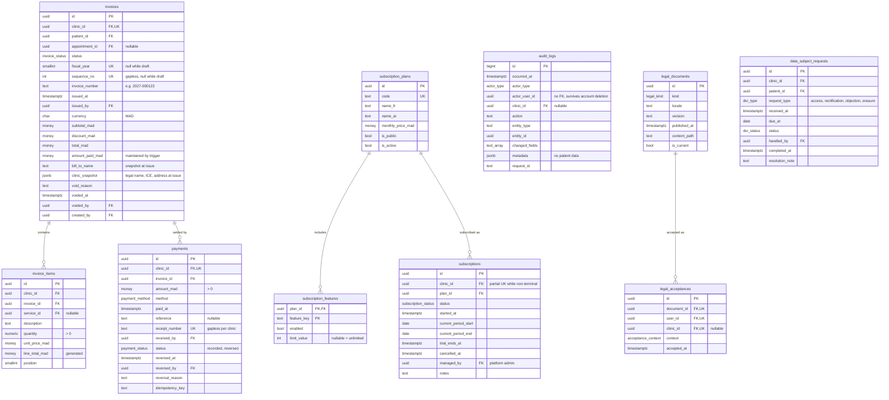

# SmartClinic — Database Entity Relationship Diagrams

| | |
| --- | --- |
| Status | **Draft for review** (system modeling phase). No migration exists yet |
| Date | 2026-11-10 |
| Related | [DOMAIN_MODEL.md](DOMAIN_MODEL.md) §6 (semantics, constraints, lifecycle) · [SECURITY_MODEL.md](SECURITY_MODEL.md) (RLS) |

## How to read these diagrams

- **§1 is the overview:** every entity and relationship, without columns.
- **§2–§9 detail one bounded context each**, with column types and keys. They repeat a few entities from neighboring contexts (with key columns only) so each diagram stands alone.
- Keys: `PK` primary key, `FK` foreign key, `UK` part of a unique constraint.
- **Composite tenant foreign keys** are shown as their individual columns marked `FK`. For example, `appointments.clinic_id` and `appointments.doctor_id` together reference `doctors (clinic_id, id)`. Every tenant-owned table has `unique (clinic_id, id)`.
- **Column types:**
  - `money` here means `numeric(12,2)` amounts in MAD. It is not PostgreSQL's `money` type, which will not be used.
  - `int_array` means `int[]`.
  - `text_array` means `text[]`.
- `auth_users` stands for Supabase's `auth.users`.
- Timestamps `created_at` and `updated_at` are omitted where they add nothing.

---

## 1. Overview

```mermaid
erDiagram
    auth_users ||--|| user_profiles : "has profile"
    auth_users ||--o| platform_admins : "may be"
    auth_users ||--o{ clinic_members : "member through"
    auth_users ||--o{ patient_accounts : "portal access through"
    auth_users ||--o{ legal_acceptances : accepts

    permissions ||--o{ role_permissions : "granted by"

    clinics ||--|| clinic_settings : "configured by"
    clinics ||--o{ clinic_members : has
    clinics ||--o{ clinic_invitations : issues
    clinics ||--o{ clinic_closures : "closed on"
    clinics ||--o{ clinic_counters : numbers
    clinics ||--o{ services : offers
    clinics ||--o{ doctors : "works with"
    clinics ||--o{ patients : registers
    clinics ||--o{ subscriptions : holds
    clinics ||--o{ queue_display_screens : shows
    clinics ||--o{ domain_events : emits
    clinics |o--o{ audit_logs : scopes

    clinic_members ||--o| doctors : "practises as"
    specialties |o--o{ services : categorizes
    specialties |o--o{ doctors : "primary specialty"
    doctors ||--o{ doctor_services : provides
    services ||--o{ doctor_services : "provided as"
    doctors ||--o{ doctor_schedules : has
    doctor_schedules ||--o{ doctor_availability : contains
    doctors ||--o{ doctor_time_off : takes

    patients ||--o{ patient_accounts : "linked to"
    patients ||--o{ patient_consents : gives
    patients |o--o{ patients : "merged into"
    patients ||--o{ appointments : attends
    doctor_services ||--o{ appointments : "booked as"
    appointments ||--|{ appointment_history : records

    doctors ||--o{ doctor_sessions : works
    doctor_sessions ||--o{ queue_entries : orders
    appointments ||--o{ queue_entries : "queued as"
    queue_entries ||--o{ queue_events : logs
    doctor_sessions ||--o{ queue_events : logs
    doctor_services ||--o| consultation_duration_stats : "measured by"

    notification_templates ||--o{ notifications : renders
    patients |o--o{ notifications : receives
    appointments |o--o{ notifications : "about"
    notifications ||--o{ notification_attempts : "attempted by"

    patients ||--o{ invoices : "billed to"
    appointments |o--o{ invoices : "billed by"
    invoices ||--o{ invoice_items : contains
    services |o--o{ invoice_items : "priced from"
    invoices ||--o{ payments : "settled by"

    subscription_plans ||--o{ subscription_features : includes
    subscription_plans ||--o{ subscriptions : "subscribed as"

    legal_documents ||--o{ legal_acceptances : "accepted as"
    patients ||--o{ data_subject_requests : files
```

---

## 2. Identity & Access

## 3. Tenancy

## 4. Practice Catalog and Scheduling

## 5. Patients

## 6. Appointments

## 7. Patient Flow (SmartFlow)

## 8. Communications

## 9. Billing, Subscriptions and Compliance

---

## 10. Enumerated types

| Type | Values |
| --- | --- |
| `clinic_role` | `clinic_owner`, `clinic_admin`, `doctor`, `receptionist`, `accountant` |
| `member_status` | `active`, `suspended`, `removed` |
| `clinic_status` | `pending_approval`, `active`, `suspended`, `closed` |
| `appointment_status` | `pending`, `confirmed`, `checked_in`, `in_progress`, `completed`, `cancelled`, `no_show` |
| `appointment_source` | `staff`, `online`, `walk_in` |
| `cancellation_actor` | `patient`, `clinic`, `system` |
| `cancellation_reason` | `patient_request`, `clinic_request`, `doctor_unavailable`, `duplicate`, `left_before_consultation`, `not_confirmed_in_time`, `other` |
| `session_status` | `planned`, `open`, `paused`, `closed` |
| `queue_state` | `waiting`, `called`, `in_consultation`, `closed` |
| `queue_outcome` | `completed`, `left`, `cancelled` |
| `priority_reason` | `elderly`, `pregnancy`, `disability`, `young_child`, `staff_judgement`, `other` |
| `notification_status` | `scheduled`, `processing`, `sent`, `delivered`, `failed`, `cancelled`, `skipped` |
| `notification_event` | `booking_received`, `appointment_confirmation`, `appointment_reminder`, `appointment_rescheduled`, `appointment_cancellation`, `doctor_delay`, `turn_approaching`, `staff_invitation`, `clinic_status_changed` |
| `channel` | `email`, `sms`, `whatsapp`, `push` |
| `invoice_status` | `draft`, `issued`, `partially_paid`, `paid`, `void` |
| `payment_method` | `cash`, `card`, `bank_transfer`, `cheque`, `other` |
| `payment_status` | `recorded`, `reversed` |
| `subscription_status` | `trialing`, `active`, `past_due`, `cancelled`, `expired` |
| `consent_purpose` | `data_processing`, `reminders_sms`, `reminders_whatsapp`, `reminders_email` |

New values are added by migration only. PostgreSQL enums can gain values but cannot drop them, so the lists start small.

## 11. Required extensions

| Extension | Used for |
| --- | --- |
| `btree_gist` | Exclusion constraints combining `=` on uuid with `&&` on ranges (appointments, schedules, closures) |
| `citext` | Case-insensitive email and slug |
| `pg_trgm` | Patient name search |
| `pg_cron`, `pg_net` | Scheduled jobs and worker invocation ([SYSTEM_ARCHITECTURE.md](SYSTEM_ARCHITECTURE.md) §5.3) |
