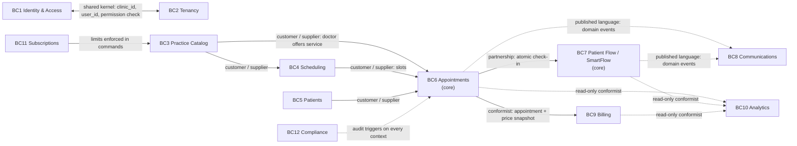
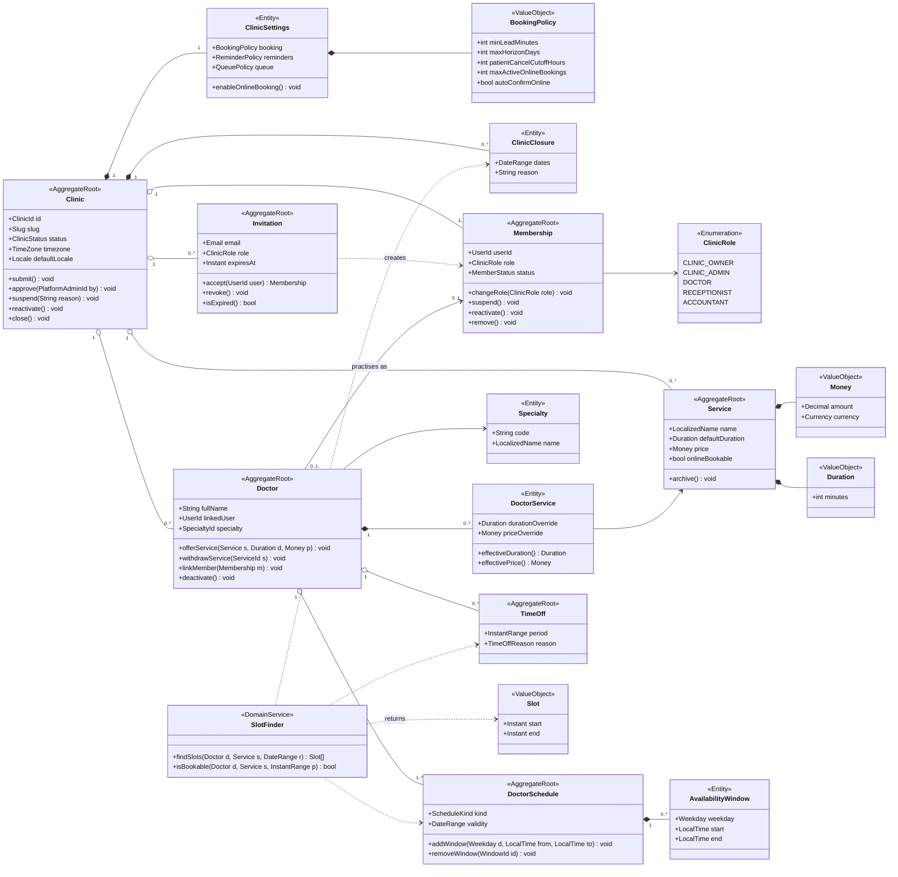
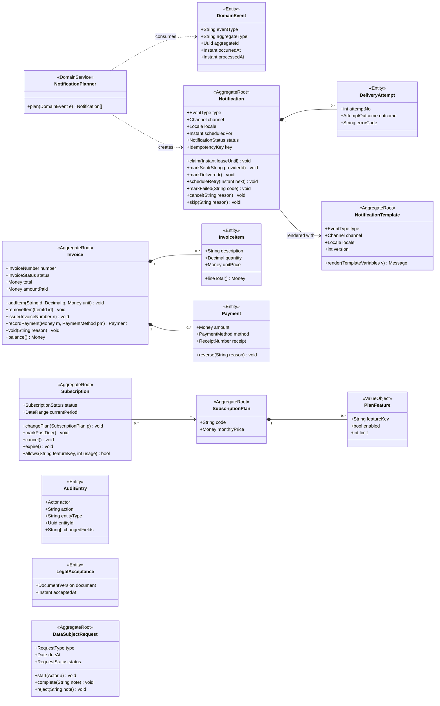

# SmartCabin — Domain Model

| | |
| --- | --- |
| Status | **Draft for review** (system modeling phase) |
| Date | 2026-11-10 |
| Assumptions | D-0 = Option A (Next.js + Supabase); audit defaults A1–A18 accepted. Both are listed in [MODELING_REVIEW.md](MODELING_REVIEW.md) |
| Related | [DATABASE_ERD.md](DATABASE_ERD.md) (column types and keys) · [BUSINESS_RULES.md](BUSINESS_RULES.md) (state machines, rules) · [RBAC_PERMISSION_MATRIX.md](RBAC_PERMISSION_MATRIX.md) |

This document defines the bounded contexts, aggregates, domain events and **every domain entity**. For each entity it covers purpose, ownership, attributes, relationships, constraints and lifecycle. Column types and keys are drawn in [DATABASE_ERD.md](DATABASE_ERD.md).

---

## 1. Ubiquitous language

| Term | Meaning |
| --- | --- |
| **Clinic** | The tenant: an independent doctor's practice, a private clinic or a medical center. It is the data controller for its patients |
| **Member** | A staff user's membership in one clinic, with one administrative role |
| **Practitioner** | A `doctors` record: someone who sees patients in a clinic. Linking it to a member gives that member the "own" practitioner scope |
| **Patient record** | A clinic-scoped administrative file (*dossier*). The same person has one record **per clinic** |
| **Patient account** | A portal login (phone OTP), linked to one or more patient records (self and dependents) |
| **Service** | Something a clinic offers, with a default duration and price (consultation, follow-up, ultrasound…) |
| **Schedule** | A period of validity (regular or override, such as Ramadan hours) containing weekly availability windows |
| **Slot** | A computed bookable interval. It is never stored |
| **Session** | One doctor's working day in one clinic. It owns that day's queue |
| **Queue entry / ticket** | A checked-in appointment waiting for, or in, consultation |
| **Estimate** | Predicted consultation start time. Always shown as a prediction, never as a promise |
| **Outbox** | Rows written in the same transaction as a business change, processed later by a worker |

---

## 2. Subdomains and bounded contexts

| # | Bounded context | Master-prompt modules | Subdomain | Responsibility | Owns |
| --- | --- | --- | --- | --- | --- |
| BC1 | **Identity & Access** | 1 Identity, 3 Membership & RBAC | Generic | Accounts, profiles, memberships, roles, permissions, invitations, platform admins | `user_profiles`, `clinic_members`, `clinic_invitations`, `permissions`, `role_permissions`, `platform_admins` |
| BC2 | **Tenancy** | 2 Tenant & Clinic, 16 Localization & Settings | Supporting | Clinic lifecycle, settings, booking policy, closures, per-clinic numbering | `clinics`, `clinic_settings`, `clinic_closures`, `clinic_counters` |
| BC3 | **Practice Catalog** | 5 Doctors, 6 Specialties & Services | Supporting | What the clinic offers and who provides it | `specialties`, `services`, `doctors`, `doctor_services` |
| BC4 | **Scheduling** | 7 Scheduling & Availability | Supporting | When doctors can be booked; slot computation | `doctor_schedules`, `doctor_availability`, `doctor_time_off` |
| BC5 | **Patients** | 4 Patient Management | Supporting | Patient records, portal links, consents, duplicate handling | `patients`, `patient_accounts`, `patient_consents` |
| BC6 | **Appointments** | 8 Appointment Management | **Core** | Booking, lifecycle, history, double-booking prevention | `appointments`, `appointment_history` |
| BC7 | **Patient Flow (SmartFlow)** | 9 Reception, 10 Queue | **Core** (differentiator) | Check-in, sessions, queue order, priorities, estimates, displays | `doctor_sessions`, `queue_entries`, `queue_events`, `consultation_duration_stats`, `queue_display_screens` |
| BC8 | **Communications** | 11 Notifications | Supporting | Turning domain events into templated, consented and deduplicated messages | `domain_events`, `notification_templates`, `notifications`, `notification_attempts` |
| BC9 | **Billing** | 12 Billing & Payments | Supporting | Invoices, items, payments, receipts, revenue | `invoices`, `invoice_items`, `payments` |
| BC10 | **Analytics** | 13 Analytics & Reporting | Generic | KPIs computed from records (read-only) | No tables of its own in the MVP (queries and functions) |
| BC11 | **Subscriptions** | 14 Subscription Management | Generic | Plans, feature limits, clinic subscriptions | `subscription_plans`, `subscription_features`, `subscriptions` |
| BC12 | **Compliance** | 15 Audit & Compliance | Generic, mandatory | Audit trail, legal acceptances, data-subject requests | `audit_logs`, `legal_documents`, `legal_acceptances`, `data_subject_requests` |

**Platform administration** is not a separate context. It is a privileged application path, a "back door with a guard", that acts on Tenancy and Subscriptions and reads aggregated Analytics. It never reads Patients, Appointments or Patient Flow rows ([RBAC_PERMISSION_MATRIX.md](RBAC_PERMISSION_MATRIX.md) §6).

### 2.1 Context map

| Relationship | Meaning in this system |
| --- | --- |
| Shared kernel (IAM ↔ Tenancy) | `clinic_id`, `auth.uid()` and the `private.has_permission()` helper are used by every context. Changes need review from both sides |
| Customer / supplier | The downstream context calls the upstream context's public commands and queries and never writes its tables (e.g. Appointments asks Scheduling for slot validity) |
| Partnership (Appointments ↔ Patient Flow) | Check-in, start and completion change an appointment and its queue entry **in one transaction**. This exception is deliberate (§3) |
| Published language | Downstream contexts react to rows in `domain_events`, with no synchronous calls. Payloads carry ids only |
| Conformist (read-only) | Analytics reads other contexts' tables as they are, through query functions, and owns no writes |

---

## 3. Aggregates and consistency boundaries

| Aggregate (root) | Contains | Invariants protected in one transaction |
| --- | --- | --- |
| Clinic | `clinic_settings`, `clinic_closures`, `clinic_counters` | Slug unique; status transitions; booking can only be enabled when status is `active` |
| Membership | — | One membership per user per clinic; **at least one active owner per clinic** |
| Invitation | — | Single use; expires; at most one pending invitation per email per clinic |
| Service | — | Duration 5–480 min in 5-minute steps; price ≥ 0 |
| Doctor | `doctor_services` | A linked user must be an active member of the same clinic; overrides respect the service's bounds |
| Doctor schedule | `doctor_availability` | Windows do not overlap within a schedule; schedules of the same kind do not overlap in dates |
| Time off | — | Valid range |
| Patient | `patient_consents`, `patient_accounts` | File number unique per clinic; merged records point to an active record |
| **Appointment** | `appointment_history` | Legal transitions only; no overlap for the same doctor unless flagged as overbooked; doctor offers the service; times consistent with status |
| **Doctor session** | `queue_entries`, `queue_events` | One session per doctor per day; gapless ticket numbers; unique sort order; one patient in consultation at a time |
| Notification | `notification_attempts` | Unique idempotency key; legal status transitions |
| **Invoice** | `invoice_items`, `payments` | Gapless number at issue; immutable once issued; payments never exceed the total |
| Subscription | — | At most one non-terminal subscription per clinic |

**Cross-aggregate transactions (deliberate exceptions).** Normally one transaction changes one aggregate. Some commands change two at once because a patient must never be "checked in" without a ticket, or the reverse: `check_in_appointment`, `register_walk_in`, `start_consultation`, `complete_consultation` and `mark_left`. They touch Appointment and Doctor session together. PostgreSQL makes this cheap and safe inside a modular monolith.

---

## 4. Domain events

Events are written to `domain_events` (outbox) by the same transaction that causes them. Payloads contain **ids only**, never names, phone numbers or reasons.

| Event | Emitted by | Consumed by |
| --- | --- | --- |
| `clinic.submitted` | `create_clinic` | Communications (platform team email) |
| `clinic.approved` / `clinic.suspended` | Platform commands | Communications (owner email) |
| `member.invited` | `invite_member` | Communications (invitation email) |
| `appointment.booked` | `book_appointment` (pending) | Communications (*booking received*) |
| `appointment.confirmed` | `book_appointment` (confirmed) / `confirm_appointment` | Communications (confirmation + reminder planning) |
| `appointment.rescheduled` | `reschedule_appointment` | Communications (cancel old reminders, notify, re-plan) |
| `appointment.cancelled` | `cancel_appointment`, pending expiry job | Communications (cancel reminders, notify) |
| `appointment.no_show` | `mark_no_show` | Analytics only (no message in the MVP) |
| `appointment.checked_in` | `check_in_appointment`, `register_walk_in` | — (realtime via triggers) |
| `consultation.completed` | `complete_consultation` | Billing (suggest draft invoice; P1) |
| `queue.turn_approaching` | Estimate recomputation | Communications (*your turn is approaching*) |
| `session.delay_reported` | `report_doctor_delay` | Communications (delay message to waiting and upcoming patients) |
| `invoice.issued`, `payment.recorded` | Billing commands | — (audit and analytics) |

Realtime screen updates do **not** go through `domain_events`. They are broadcast directly by triggers to keep latency low ([SYSTEM_ARCHITECTURE.md](SYSTEM_ARCHITECTURE.md) §5.2).

---

## 5. UML class diagrams

These diagrams show the domain layer: aggregates, entities, value objects and domain services, with their behavior. In the implementation, the authoritative behavior lives in PostgreSQL command functions, and TypeScript mirrors only what the UI needs ([API_SPECIFICATION.md](API_SPECIFICATION.md)).

### 5.1 Clinic setup (Tenancy, Identity & Access, Catalog, Scheduling)

### 5.2 Care operations (Patients, Appointments, Patient Flow)

```mermaid
classDiagram
    direction LR
    class Patient {
        <<AggregateRoot>>
        +FileNumber fileNumber
        +PersonName name
        +PhoneNumber phone
        +Date dateOfBirth
        +PatientStatus status
        +updateContact(PhoneNumber p) void
        +recordConsent(ConsentPurpose p, bool granted, String version) void
        +archive() void
        +mergeInto(Patient target) void
    }
    class PatientAccountLink {
        <<Entity>>
        +UserId account
        +Relationship relationship
        +revoke() void
    }
    class Consent {
        <<Entity>>
        +ConsentPurpose purpose
        +bool granted
        +String documentVersion
        +Instant recordedAt
    }
    class PhoneNumber {
        <<ValueObject>>
        +String e164
        +normalizeMoroccan(String raw) PhoneNumber
    }
    class Appointment {
        <<AggregateRoot>>
        +InstantRange period
        +AppointmentStatus status
        +AppointmentSource source
        +bool overbooked
        +Money priceSnapshot
        +int version
        +confirm(Actor a) void
        +reschedule(InstantRange p, Actor a) void
        +checkIn(Actor a, Instant at) void
        +start(Actor a) void
        +complete(Actor a) void
        +cancel(Actor a, CancellationReason r) void
        +markNoShow(Actor a) void
        +correctStatus(AppointmentStatus to, Actor a, String reason) void
    }
    class AppointmentStatus {
        <<Enumeration>>
        pending
        confirmed
        checked_in
        in_progress
        completed
        cancelled
        no_show
    }
    class HistoryEntry {
        <<Entity>>
        +HistoryEventType type
        +AppointmentStatus fromStatus
        +AppointmentStatus toStatus
        +Actor actor
        +Instant occurredAt
    }
    class BookingService {
        <<DomainService>>
        +book(BookingCommand c) Appointment
    }
    class DoctorSession {
        <<AggregateRoot>>
        +LocalDate serviceDate
        +SessionStatus status
        +int announcedDelayMinutes
        +long queueVersion
        +open() void
        +pause() void
        +resume() void
        +close() void
        +reportDelay(int minutes) void
        +issueTicket(Appointment a) QueueEntry
        +callNext() QueueEntry
    }
    class QueueEntry {
        <<Entity>>
        +int ticketNumber
        +QueueState state
        +PriorityLevel priority
        +Decimal sortKey
        +WaitEstimate estimate
        +call() void
        +recall() void
        +startConsultation() void
        +close(QueueOutcome o) void
        +setPriority(PriorityLevel l, PriorityReason r, Actor a) void
        +moveBefore(QueueEntry other, Actor a) void
    }
    class WaitEstimator {
        <<DomainService>>
        +recompute(DoctorSession s, DurationStats st, Instant now) WaitEstimate[]
    }
    class WaitEstimate {
        <<ValueObject>>
        +Instant expectedStart
        +int lowMinutes
        +int highMinutes
    }
    class DurationStats {
        <<ValueObject>>
        +int sampleSize
        +Decimal medianMinutes
        +Decimal p80Minutes
    }

    Patient "1" *-- "0..*" PatientAccountLink
    Patient "1" *-- "0..*" Consent
    Patient *-- PhoneNumber
    Appointment "0..*" --> "1" Patient : for
    Appointment --> AppointmentStatus
    Appointment "1" *-- "1..*" HistoryEntry
    BookingService ..> Appointment : creates
    DoctorSession "1" *-- "0..*" QueueEntry
    QueueEntry "0..1" --> "1" Appointment : tracks
    WaitEstimator ..> DoctorSession
    WaitEstimator ..> DurationStats
    QueueEntry *-- WaitEstimate
```

### 5.3 Back office (Communications, Billing, Subscriptions, Compliance)

---

## 6. Entity catalog

**Conventions for every entity, unless stated otherwise**

- `id uuid` primary key.
- `created_at` and `updated_at` (`timestamptz`), maintained by trigger.
- Tenant-owned entities also have:
  - `clinic_id uuid not null`;
  - `unique (clinic_id, id)`, which is the target of composite foreign keys;
  - RLS enabled;
  - indexes that start with `clinic_id`.
- **Write tier:**
  - **C = command table**: no direct DML for `authenticated`; writes go only through `SECURITY DEFINER` command functions that check permissions.
  - **M = managed table**: direct DML is allowed under RLS policies, with triggers for invariants and audit.
  - See [SECURITY_MODEL.md](SECURITY_MODEL.md) §4.
- **Retention:** periods marked "TBD (counsel)" await the Law 09-08 review. Until then nothing is purged automatically.

### BC1 — Identity & Access

#### `auth.users` — Account (Supabase-managed)
- **Purpose:** authentication identity for staff (email and password, TOTP MFA) and patients (phone OTP).
- **Ownership:** Supabase Auth. SmartCabin never writes it directly, only through the Auth API.
- **Relationships:** 1:1 `user_profiles`; 1:N `clinic_members`, `patient_accounts`, `legal_acceptances`; 0..1 `platform_admins`.
- **Lifecycle:** created at sign-up; email or phone confirmed; MFA factors enrolled; deleted on account-deletion request. Clinic records survive deletion, because clinics are the controllers of patient files. References from audit logs are kept as plain uuids without foreign keys.

#### `user_profiles` — User profile
- **Purpose:** application-level profile for any account.
- **Ownership:** the user (global, not tenant-scoped). Tier M (the user can update their own row).
- **Attributes:** `id` (= `auth.users.id`), `full_name`, `phone_e164` (nullable), `locale` (`fr` or `ar`), timestamps.
- **Relationships:** 1:1 `auth.users` (FK on delete cascade).
- **Constraints:** `locale in ('fr','ar')`; `phone_e164` matches `^\+[1-9][0-9]{7,14}$`.
- **Lifecycle:** created by a trigger on `auth.users` insert; updated by the user; deleted with the account.

#### `platform_admins` — Platform administrator
- **Purpose:** grants SUPER_ADMIN capabilities. This is deliberately **not** a clinic role.
- **Ownership:** platform. Tier C (only other platform admins, through a command; the first admin is created by a migration or seed).
- **Attributes:** `user_id` (PK, FK `auth.users`), `granted_by`, `granted_at`, `revoked_at`.
- **Constraints:** requires an `aal2` session for every platform operation; at least one active platform admin must exist.
- **Lifecycle:** granted → revoked. Never deleted (accountability).

#### `permissions` and `role_permissions` — Permission catalog
- **Purpose:** the single source of truth for what each role may do. It is read by the SQL helpers, and TypeScript types are generated from it.
- **Ownership:** platform reference data, written by migrations only.
- **Attributes:** `permissions(key text PK, context, description)`; `role_permissions(role clinic_role, permission_key)`, with PK (`role`, `permission_key`).
- **Lifecycle:** changed only by migration, with a matching update of [RBAC_PERMISSION_MATRIX.md](RBAC_PERMISSION_MATRIX.md). A test checks that the two agree.

#### `clinic_members` — Membership
- **Purpose:** a user's administrative role in one clinic.
- **Ownership:** tenant (clinic). Tier C.
- **Attributes:**
  - `clinic_id`, `user_id`;
  - `role` (`clinic_owner`, `clinic_admin`, `doctor`, `receptionist`, `accountant`);
  - `status` (`active`, `suspended`, `removed`);
  - `invited_by`, `joined_at`, `status_changed_at`.
- **Relationships:** N:1 `clinics`, N:1 `auth.users`; 0..1 `doctors` (through `doctors (clinic_id, user_id)`).
- **Constraints:**
  - `unique (clinic_id, user_id)`.
  - **At least one active `clinic_owner` per active clinic**: a deferred constraint trigger with a row lock on the clinic.
  - An admin cannot grant `clinic_owner` or `clinic_admin`.
  - A member cannot change their own role.
- **Lifecycle:** `active ⇄ suspended → removed`. Rows are never deleted. Removal keeps history and the row stays the target of audit references. A suspended or removed member loses all access immediately, because RLS reads status on every query.

#### `clinic_invitations` — Staff invitation *(not in the original table list)*
- **Purpose:** single-use invitation for a staff member, carrying the intended role.
- **Ownership:** tenant. Tier C.
- **Attributes:** `clinic_id`, `email` (citext), `role`, `token_hash` (SHA-256 of a random token; the token itself is never stored), `invited_by`, `expires_at` (default 7 days), `accepted_at`, `accepted_by`, `revoked_at`.
- **Constraints:** `unique (token_hash)`; partial unique `(clinic_id, email)` while pending; `expires_at > created_at`.
- **Lifecycle:** `pending → accepted | revoked | expired` (expired is derived from `expires_at`). Accepting creates the `clinic_members` row in the same transaction. Retention: purged 90 days after leaving `pending`.

### BC2 — Tenancy

#### `clinics` — Clinic (tenant)
- **Purpose:** the tenant root.
- **Ownership:** two separate actions:
  - the clinic administers its profile (owner and admin, tier C command `update_clinic_profile`);
  - the platform administers its **status** (platform path only).
- **Attributes:**
  - `slug` (citext, unique, used in URLs and booking links);
  - `display_name`, `legal_name`, `city`, `address_line`, `phone_e164`, `email`;
  - `timezone` (default `Africa/Casablanca`), `default_locale`;
  - `ice` (company identifier for invoices, nullable until billing is used);
  - `logo_path`;
  - `status` (`pending_approval`, `active`, `suspended`, `closed`), `approved_at`, `approved_by`, `suspended_reason`, `closed_at`;
  - `created_by`.
- **Relationships:** 1:1 `clinic_settings`; 1:N for every tenant-owned table.
- **Constraints:** slug matches `^[a-z0-9](-?[a-z0-9]){2,40}$` and is not in a reserved list (`admin`, `api`, `app`…); `timezone` is a valid IANA name (checked against `pg_timezone_names`).
- **Lifecycle:** `pending_approval → active ⇄ suspended → closed`; `pending_approval → closed` (rejected).
  - In `pending_approval`, setup is allowed but public booking and patient notifications are off.
  - `suspended` is read-only for staff and booking is off.
  - `closed` allows only export, then purge after the retention period (TBD, counsel).

#### `clinic_settings` — Clinic settings
- **Purpose:** operational policy for booking, reminders and queue behavior.
- **Ownership:** tenant. Tier M (owner and admin).
- **Attributes:**
  - `clinic_id` (PK);
  - booking: `online_booking_enabled`, `auto_confirm_online`, `min_lead_minutes` (default 60), `max_horizon_days` (60), `patient_cancel_cutoff_hours` (2), `max_active_online_bookings` (3);
  - reminders and queue: `reminder_offsets_minutes int[]` (default `{1440}`), `checkin_grace_minutes` (15), `turn_approaching_positions` (2);
  - `sms_sender_name` (neutral name);
  - `updated_by`.
- **Constraints:** every number within a sane range; `online_booking_enabled` can only be true while the clinic is `active` (trigger).
- **Lifecycle:** created with the clinic; updated in place (changes audited).

#### `clinic_closures` — Clinic closure *(added)*
- **Purpose:** whole-clinic closed days (public holidays, Eid, inventory days). It removes slots for every doctor.
- **Ownership:** tenant. Tier M.
- **Attributes:** `clinic_id`, `dates daterange` (local dates), `reason`, `created_by`.
- **Constraints:** non-empty range; no overlap per clinic (exclusion constraint).
- **Lifecycle:** created → deleted. Deletion is allowed and audited. Appointments that fall inside a new closure are **not** cancelled automatically: the command returns them so staff can reschedule.

#### `clinic_counters` — Per-clinic counters *(added)*
- **Purpose:** gapless numbering inside the transaction that consumes the number (invoices, receipts, patient file numbers).
- **Ownership:** tenant, internal. Written only by command functions (row lock `FOR UPDATE`).
- **Attributes:** `clinic_id`, `counter_key` (`invoice:2027`, `receipt:2027`, `patient_file`), `next_value bigint`, with PK (`clinic_id`, `counter_key`).
- **Lifecycle:** created on first use; never decremented or deleted.

### BC3 — Practice Catalog

#### `specialties` — Medical specialty
- **Purpose:** platform-wide reference list (general medicine, pediatrics, gynecology…).
- **Ownership:** platform reference data. Readable by everyone, including anonymous users; writable by platform admins.
- **Attributes:** `code` (unique), `name_fr`, `name_ar`, `is_active`.
- **Lifecycle:** active → inactive. Never deleted once referenced.

#### `services` — Service
- **Purpose:** a bookable or billable service offered by the clinic.
- **Ownership:** tenant. Tier M (owner and admin).
- **Attributes:** `clinic_id`, `specialty_id` (nullable), `name_fr`, `name_ar`, `default_duration_minutes`, `price_mad numeric(12,2)`, `online_bookable`, `status` (`active` or `archived`).
- **Relationships:** N:1 `specialties`; 1:N `doctor_services`, `invoice_items`.
- **Constraints:**
  - `default_duration_minutes between 5 and 480` and a multiple of 5;
  - `price_mad >= 0`;
  - at least one of `name_fr` and `name_ar` is not null;
  - unique active name per clinic.
- **Lifecycle:** `active ⇄ archived`. Never hard-deleted once referenced; archived services cannot be booked.

#### `doctors` — Practitioner (per clinic)
- **Purpose:** someone who sees patients in this clinic. A person working in two clinics has **two rows**, one owned by each clinic.
- **Ownership:** tenant. Tier M (owner and admin).
- **Attributes:** `clinic_id`, `user_id` (nullable: a doctor without a login is allowed), `full_name`, `full_name_ar`, `specialty_id`, `inpe` (national health-professional id, nullable, need to be confirmed), `phone_e164` (professional), `online_bookable`, `status` (`active` or `inactive`).
- **Relationships:**
  - composite FK `(clinic_id, user_id) → clinic_members (clinic_id, user_id)`, so a linked user **must be a member of the same clinic**;
  - 1:N `doctor_services`, `doctor_schedules`, `doctor_time_off`, `appointments`, `doctor_sessions`.
- **Constraints:** partial unique `(clinic_id, user_id)` where `user_id` is not null.
- **Lifecycle:** `active ⇄ inactive`. An inactive doctor cannot receive new bookings; existing future appointments are listed for rescheduling. Never deleted once referenced.

#### `doctor_services` — Service offered by a doctor
- **Purpose:** which doctor provides which service, with optional overrides.
- **Ownership:** tenant. Tier M.
- **Attributes:** `clinic_id`, `doctor_id`, `service_id`, `duration_minutes` (override, nullable), `price_mad` (override, nullable), `online_bookable`, `is_active`.
- **Relationships:** PK `(clinic_id, doctor_id, service_id)`; composite FKs to `doctors` and `services`; **target of the composite FK from `appointments`**.
- **Constraints:** overrides follow the same bounds as `services`.
- **Lifecycle:** active ⇄ inactive. Rows are never deleted once an appointment references them.

### BC4 — Scheduling

#### `doctor_schedules` — Schedule period *(refinement of `doctor_availability`)*
- **Purpose:** a set of weekly windows valid over a date range.
  - `regular` covers the normal week.
  - `override` replaces the regular schedule for its dates, for example *Ramadan 2027 hours* or *summer hours*.
- **Ownership:** tenant. Tier M (owner and admin; the linked doctor for their own schedule).
- **Attributes:** `clinic_id`, `doctor_id`, `name`, `kind` (`regular` or `override`), `valid_from date`, `valid_until date` (nullable = open-ended).
- **Constraints:** `valid_until >= valid_from`; **exclusion constraint** so that schedules of the same kind for the same doctor do not overlap in dates.
- **Lifecycle:** created → edited → ended (by setting `valid_until`). Past periods are kept for utilization analytics.

#### `doctor_availability` — Weekly availability window
- **Purpose:** an interval of local wall-clock time on a weekday within a schedule.
- **Ownership:** tenant. Tier M.
- **Attributes:** `clinic_id`, `schedule_id`, `doctor_id` (denormalized for composite FK and lookups), `weekday` (ISO 1 = Monday … 7 = Sunday), `start_time time`, `end_time time`.
- **Constraints:** `end_time > start_time` (no overnight windows in the MVP); **exclusion constraint** so that windows in the same schedule and weekday do not overlap (custom `timerange` type).
- **Lifecycle:** created → deleted, with the edit audited. Changes never alter existing appointments; affected future appointments are reported.

#### `doctor_time_off` — Time off
- **Purpose:** an interval in which a doctor cannot be booked (leave, training, sickness, partial day).
- **Ownership:** tenant. Tier M (owner, admin, receptionist; the linked doctor for themself).
- **Attributes:** `clinic_id`, `doctor_id`, `period tstzrange`, `reason_category` (`leave`, `training`, `sick`, `personal`, `other`), `note` (staff-only, no medical detail), `created_by`.
- **Constraints:** non-empty range; GiST index.
- **Lifecycle:** created → deleted. Conflicting appointments are reported, not cancelled automatically.

**Slot (value object, not stored).** Slots are computed by `get_available_slots(doctor, service, from, to)`. The computation, done in local dates and converted to UTC per date:
1. Take the applicable schedule windows: the override schedule if one covers the date, otherwise the regular one.
2. Subtract time off, clinic closures and active appointments.
3. Subtract anything inside the minimum lead time or beyond the booking horizon.
4. Step through what remains by the effective service duration.

### BC5 — Patients

#### `patients` — Patient record (per clinic)
- **Purpose:** the clinic's administrative file for one person. **No clinical content** in the MVP.
- **Ownership:** tenant (the clinic is the data controller). Tier M (owner, admin, receptionist).
- **Attributes:**
  - `clinic_id`;
  - `file_number` (from `clinic_counters`);
  - `first_name`, `last_name`, `first_name_ar`, `last_name_ar`;
  - `sex` (nullable), `date_of_birth` (nullable);
  - `phone_e164` (nullable, **not unique**), `email` (nullable);
  - `preferred_locale`, `preferred_channel` (`sms`, `whatsapp`, `email`, `none`);
  - `status` (`active`, `archived`, `merged`), `merged_into_id`;
  - `created_via` (`reception`, `online`, `walk_in`, `import`), `created_by`, `archived_at`.
- **Relationships:** 1:N `patient_accounts`, `patient_consents`, `appointments`, `invoices`, `notifications`, `data_subject_requests`.
- **Constraints:**
  - `unique (clinic_id, file_number)`;
  - `status = 'merged'` ⇔ `merged_into_id` is not null, and the target is in the same clinic (composite FK) and is not itself merged;
  - trigram index on names and an index on `(clinic_id, phone_e164)` for search and duplicate hints;
  - date of birth is not in the future.
- **Lifecycle:** `active → archived` (still readable, cannot be booked) → anonymized or purged after the retention period (TBD, counsel). `active → merged`: appointments, invoices and links are moved to the target in one transaction.

#### `patient_accounts` — Portal link *(added)*
- **Purpose:** connects a portal account (phone OTP) to the patient records it may act for: self and dependents.
- **Ownership:** tenant. Tier C (portal commands and staff commands).
- **Attributes:** `user_id`, `clinic_id`, `patient_id`, `relationship` (`self`, `child`, `other_dependent`), `linked_via` (`online_booking`, `staff`), `linked_at`, `revoked_at`.
- **Constraints:** partial unique `(user_id, patient_id)` while active; composite FK to `patients`.
- **Lifecycle:** `active → revoked`. Links are **never created automatically by matching a phone number**, because families share phones. A link is created either when the account books for a new record or when staff link it explicitly.

#### `patient_consents` — Consent record
- **Purpose:** evidence of consent for each processing purpose and communication channel.
- **Ownership:** tenant. Tier C (append-only).
- **Attributes:** `clinic_id`, `patient_id`, `purpose` (`data_processing`, `reminders_sms`, `reminders_whatsapp`, `reminders_email`), `granted bool`, `document_version`, `source` (`online`, `reception`, `paper`), `recorded_by_user_id`, `recorded_at`.
- **Constraints:** append-only (no update or delete). The current consent is the latest row per (`patient_id`, `purpose`).
- **Lifecycle:** a new row for each grant or withdrawal. Kept as long as the patient record exists, plus the retention period.

### BC6 — Appointments

#### `appointments` — Appointment
- **Purpose:** one reserved time for one patient with one doctor for one service. It is also the backbone of walk-ins, the queue, billing and analytics.
- **Ownership:** tenant. **Tier C**: every change goes through command functions.
- **Attributes:**
  - `clinic_id`, `patient_id`, `doctor_id`, `service_id`;
  - `starts_at`, `ends_at` (`timestamptz`);
  - `status` (7 states), `source` (`staff`, `online`, `walk_in`);
  - `is_overbooked`, `overbook_reason`;
  - `patient_reason` (≤ 200 characters, optional, staff-only);
  - `price_mad` (snapshot at booking);
  - `idempotency_key`, `booked_by_user_id`;
  - lifecycle timestamps: `confirmed_at`, `checked_in_at`, `started_at`, `completed_at`, `cancelled_at`, `no_show_at`;
  - cancellation: `cancelled_by_user_id`, `cancellation_actor` (`patient`, `clinic`, `system`), `cancellation_reason`;
  - `version` (optimistic concurrency).
- **Relationships:**
  - composite FKs `(clinic_id, patient_id) → patients` and **`(clinic_id, doctor_id, service_id) → doctor_services`**, so "the doctor provides the service" is enforced by the database;
  - 1:N `appointment_history`, `notifications`; 0..1 active `queue_entries`; 0..N `invoices`.
- **Constraints:**
  - `ends_at > starts_at`; duration a multiple of 5 minutes, between 5 and 480;
  - **exclusion constraint** against overlap for the same doctor when status is in (`pending`, `confirmed`, `checked_in`, `in_progress`) and the appointment is not overbooked;
  - status/timestamp coherence checks (e.g. `status = 'cancelled'` ⇒ `cancelled_at` and `cancellation_reason` are not null);
  - `overbook_reason` is required when `is_overbooked`;
  - partial unique `(clinic_id, idempotency_key)`.
- **Lifecycle:** see the state machine in [BUSINESS_RULES.md](BUSINESS_RULES.md) §2. **Never deleted.** Retention is TBD (counsel).

#### `appointment_history` — Appointment history *(renamed from `appointment_status_history`)*
- **Purpose:** append-only trail of every status change **and** reschedule, so a reschedule keeps its old time.
- **Ownership:** tenant. Written only by a trigger on `appointments`.
- **Attributes:** `id bigint identity`, `clinic_id`, `appointment_id`, `event_type` (`created`, `status_changed`, `rescheduled`, `details_changed`), `from_status`, `to_status`, `previous_starts_at`, `new_starts_at`, `actor_type`, `actor_user_id`, `reason`, `occurred_at`.
- **Constraints:** append-only (UPDATE and DELETE revoked from all application roles).
- **Lifecycle:** same retention as its appointment.

### BC7 — Patient Flow (SmartFlow)

#### `doctor_sessions` — Doctor's day *(added)*
- **Purpose:** one doctor's working day in one clinic. It owns the queue, ticket counter, delay and queue version.
- **Ownership:** tenant. Tier C.
- **Attributes:** `clinic_id`, `doctor_id`, `service_date` (local date), `status` (`planned`, `open`, `paused`, `closed`), `opened_at`, `closed_at`, `announced_delay_minutes`, `delay_reported_at`, `delay_reported_by`, `next_ticket_number`, `queue_version bigint`.
- **Constraints:** `unique (clinic_id, doctor_id, service_date)`; `announced_delay_minutes between 0 and 600`.
- **Lifecycle:** `planned → open ⇄ paused → closed`. Created lazily at the first check-in or delay report of the day; closed by staff or by the end-of-day job.

#### `queue_entries` — Queue entry (ticket)
- **Purpose:** a checked-in appointment's place in the doctor's queue.
- **Ownership:** tenant. Tier C.
- **Attributes:**
  - `clinic_id`, `session_id`, `appointment_id`, `doctor_id`;
  - `ticket_number`;
  - `state` (`waiting`, `called`, `in_consultation`, `closed`), `outcome` (`completed`, `left`, `cancelled`);
  - priority: `priority_level` (0 normal, 1 priority), `priority_reason` (`elderly`, `pregnancy`, `disability`, `young_child`, `staff_judgement`, `other`), `priority_set_by`;
  - ordering: `sort_key numeric`;
  - timestamps: `checked_in_at`, `called_at`, `call_count`, `consultation_started_at`, `closed_at`;
  - estimate: `estimated_start_at`, `estimate_computed_at`.
- **Constraints:**
  - partial unique `(appointment_id)` while not closed;
  - `unique (session_id, ticket_number)`;
  - partial unique `(session_id)` where `state = 'in_consultation'` (one patient at a time per doctor);
  - `outcome` is not null ⇔ `state = 'closed'`;
  - priority level 1 ⇒ reason and setter are not null.
- **Lifecycle:** see [BUSINESS_RULES.md](BUSINESS_RULES.md) §3. Kept with the appointment (needed for wait-time analytics).

#### `queue_events` — Queue event log
- **Purpose:** append-only operational trail: check-in, call, recall, priority change, reorder, start, completion, left, delay.
- **Ownership:** tenant. Written by command functions.
- **Attributes:** `id bigint identity`, `clinic_id`, `session_id`, `queue_entry_id` (nullable for session-level events), `event_type`, `actor_user_id`, `reason`, `details jsonb` (ids and numbers only), `occurred_at`.
- **Constraints:** append-only.
- **Lifecycle:** retention TBD (operational data; proposal: 24 months).

#### `consultation_duration_stats` — Duration statistics *(added, derived)*
- **Purpose:** historical consultation durations per doctor and service, used by the estimator once enough data exists.
- **Ownership:** tenant, derived. Rebuilt nightly by a job from completed queue entries.
- **Attributes:** `clinic_id`, `doctor_id`, `service_id`, `sample_size`, `median_minutes`, `p80_minutes`, `window_days` (90), `computed_at`. PK (`clinic_id`, `doctor_id`, `service_id`).
- **Lifecycle:** overwritten nightly. It can be deleted and rebuilt at any time.

#### `queue_display_screens` — Waiting-room display *(added, P1)*
- **Purpose:** a token-authenticated screen that shows ticket numbers being called. **No names.**
- **Ownership:** tenant. Tier C (owner and admin).
- **Attributes:** `clinic_id`, `name`, `token_hash`, `doctor_id` (nullable = all doctors), `created_by`, `last_seen_at`, `revoked_at`.
- **Lifecycle:** `active → revoked`.

### BC8 — Communications

#### `domain_events` — Outbox *(added)*
- **Purpose:** reliable hand-off of business facts to asynchronous consumers.
- **Ownership:** tenant (nullable for platform events). Written only by command functions.
- **Attributes:** `id bigint identity`, `clinic_id`, `aggregate_type`, `aggregate_id`, `event_type`, `payload jsonb` (ids only), `occurred_at`, `processed_at`, `attempts`, `last_error`.
- **Constraints:** partial index on unprocessed rows. Consumers must be idempotent.
- **Lifecycle:** `unprocessed → processed`. Purged 30 days after processing.

#### `notification_templates` — Message template
- **Purpose:** versioned text for each event, channel and locale.
- **Ownership:** platform defaults (`clinic_id` null). Clinic overrides come later (P2).
- **Attributes:** `clinic_id`, `event_type`, `channel` (`email`, `sms`, `whatsapp`, `push`), `locale`, `version`, `subject`, `body`, `is_active`, `created_by`.
- **Constraints:**
  - unique (`clinic_id`, `event_type`, `channel`, `locale`, `version`);
  - one active version per (`clinic_id`, `event_type`, `channel`, `locale`);
  - **SMS and WhatsApp bodies may only use the allowed placeholders**: clinic display name, date, time, ticket number and an opaque link. No service, specialty, doctor specialty or reason.
- **Lifecycle:** new version → activate → deactivate. Never edited in place once used.

#### `notifications` — Notification (outbound message)
- **Purpose:** one message to one recipient on one channel. It is also the delivery-status record.
- **Ownership:** tenant. Written by the planner and the dispatcher (worker).
- **Attributes:**
  - `clinic_id`;
  - recipient reference: `patient_id`, `user_id` or `invitation_id` (exactly one is not null);
  - context: `appointment_id`, `queue_entry_id`;
  - `event_type`, `channel`, `locale`, `template_id`;
  - `scheduled_for`, `status`, `idempotency_key`;
  - delivery: `attempt_count`, `next_attempt_at`, `locked_until` (lease), `provider`, `provider_message_id`, `sent_at`, `delivered_at`, `failed_at`;
  - `skip_reason`.
- **Constraints:** `unique (idempotency_key)`, for example `appointment_reminder:<appointment_id>:<starts_at>:<channel>:1440`; exactly-one-recipient check; `attempt_count <= 5`.
- **Lifecycle:** see [BUSINESS_RULES.md](BUSINESS_RULES.md) §6. The recipient's address is resolved **at send time**, so a corrected phone number is used. Retention: 12 months (proposal).

#### `notification_attempts` — Delivery attempt *(added)*
- **Purpose:** diagnostics for each provider call.
- **Ownership:** tenant. Written by the dispatcher.
- **Attributes:** `clinic_id`, `notification_id`, `attempt_no`, `provider`, `recipient_masked` (e.g. `+2126•••••12`), `started_at`, `finished_at`, `outcome` (`accepted`, `rejected`, `error`, `timeout`), `provider_status`, `error_code`.
- **Lifecycle:** append-only; same retention as its notification.

### BC9 — Billing

#### `invoices` — Invoice
- **Purpose:** a bill for one patient, usually for one appointment.
- **Ownership:** tenant. Tier C.
- **Attributes:**
  - `clinic_id`, `patient_id`, `appointment_id` (nullable);
  - `status` (`draft`, `issued`, `partially_paid`, `paid`, `void`);
  - numbering: `fiscal_year`, `sequence_no`, `invoice_number` (e.g. `2027-000123`);
  - issue: `issued_at`, `issued_by`;
  - amounts: `currency` (`MAD`), `subtotal_mad`, `discount_mad`, `total_mad`, `amount_paid_mad` (maintained by trigger);
  - snapshots at issue: `bill_to_name`, `clinic_snapshot jsonb` (legal name, ICE, address);
  - `notes`, `void_reason`, `voided_at`, `voided_by`, `created_by`.
- **Relationships:** 1:N `invoice_items`, `payments`; composite FKs to `patients` and `appointments`.
- **Constraints:**
  - number fields are null ⇔ `status = 'draft'`;
  - `unique (clinic_id, fiscal_year, sequence_no)`;
  - `total = subtotal - discount >= 0`;
  - `0 <= amount_paid <= total`;
  - **immutable after issue** except status, amount paid and void fields (trigger).
- **Lifecycle:** see [BUSINESS_RULES.md](BUSINESS_RULES.md) §5. Drafts can be discarded. Issued invoices are never deleted. Retention follows legal accounting rules (TBD, accountant).

#### `invoice_items` — Invoice line
- **Ownership:** tenant. Tier C (editable only while the invoice is a draft).
- **Attributes:** `clinic_id`, `invoice_id`, `service_id` (nullable), `description`, `quantity numeric(8,2)`, `unit_price_mad`, `line_total_mad` (generated), `position`.
- **Constraints:** `quantity > 0`; `unit_price_mad >= 0`; immutable once the invoice is issued.

#### `payments` — Payment
- **Purpose:** money received against an invoice. Each payment has its own receipt number.
- **Ownership:** tenant. Tier C. Part of the Invoice aggregate.
- **Attributes:** `clinic_id`, `invoice_id`, `amount_mad`, `method` (`cash`, `card`, `bank_transfer`, `cheque`, `other`), `paid_at`, `reference`, `receipt_number` (gapless, from `clinic_counters`), `received_by`, `status` (`recorded` or `reversed`), `reversed_at`, `reversed_by`, `reversal_reason`, `idempotency_key`.
- **Constraints:**
  - `amount_mad > 0`;
  - `unique (clinic_id, receipt_number)`;
  - the sum of recorded payments ≤ invoice total, checked with the invoice row locked;
  - payments only on `issued` or `partially_paid` invoices.
- **Lifecycle:** `recorded → reversed`. Never deleted.

### BC10 — Analytics

There are no owned tables in the MVP. KPIs are computed by `SECURITY INVOKER` query functions over the operational tables, so RLS still applies. Definitions are in [BUSINESS_RULES.md](BUSINESS_RULES.md) §8. A nightly `daily_clinic_metrics` snapshot table may be added if the queries become slow (decided by measurement, not in advance).

### BC11 — Subscriptions

#### `subscription_plans` — Plan
- **Ownership:** platform. Writable by platform admins; active public plans are readable by anyone.
- **Attributes:** `code` (unique), `name_fr`, `name_ar`, `monthly_price_mad`, `is_public`, `is_active`.
- **Lifecycle:** active → retired. Never deleted while a subscription references it.

#### `subscription_features` — Plan feature or limit
- **Ownership:** platform.
- **Attributes:** `plan_id`, `feature_key` (`max_doctors`, `max_staff`, `monthly_sms_quota`, `online_booking`, `queue_display`, …), `enabled`, `limit_value` (nullable = unlimited). PK (`plan_id`, `feature_key`).

#### `subscriptions` — Clinic subscription
- **Ownership:** two separate roles:
  - the platform writes it (manual billing during the pilot);
  - the clinic owner can read it.
- **Attributes:** `clinic_id`, `plan_id`, `status` (`trialing`, `active`, `past_due`, `cancelled`, `expired`), `started_at`, `current_period_start`, `current_period_end`, `trial_ends_at`, `cancelled_at`, `managed_by`, `notes`.
- **Constraints:** partial unique `(clinic_id)` where status is in (`trialing`, `active`, `past_due`); period end > start.
- **Lifecycle:** see [BUSINESS_RULES.md](BUSINESS_RULES.md) §7. Limits are enforced inside commands (e.g. `create_doctor` checks `max_doctors`).

### BC12 — Compliance

#### `audit_logs` — Audit entry
- **Purpose:** who did what, when, to which entity.
- **Ownership:** tenant or platform (`clinic_id` nullable). Insert only through triggers and definer functions.
- **Attributes:** `id bigint identity`, `occurred_at`, `actor_type` (`user`, `patient`, `platform_admin`, `system`), `actor_user_id`, `clinic_id`, `action` (e.g. `appointment.cancel`, `patient.viewed`), `entity_type`, `entity_id`, `changed_fields text[]`, `metadata jsonb` (no patient data), `request_id`.
- **Constraints:** **append-only** for every role; monthly partitioning once volume requires it.
- **Lifecycle:** retention TBD (counsel; proposal: 5 years). Opening a patient's detail view is logged (`patient.viewed`); list queries are not.

#### `legal_documents` — Legal document version *(added)*
- **Ownership:** platform.
- **Attributes:** `kind` (`terms_of_service`, `privacy_policy`, `clinic_dpa`, `patient_privacy_notice`), `locale`, `version`, `published_at`, `content_path`, `is_current`.
- **Lifecycle:** published → superseded. Never deleted.

#### `legal_acceptances` — Acceptance *(added)*
- **Ownership:** the user, with an optional tenant context.
- **Attributes:** `document_id`, `user_id`, `clinic_id` (for the clinic data processing agreement), `context` (`signup`, `clinic_creation`, `online_booking`), `accepted_at`.
- **Constraints:** append-only; unique (`document_id`, `user_id`, `clinic_id`).

#### `data_subject_requests` — Patient-rights request *(added, P1)*
- **Purpose:** track Law 09-08 access, rectification, objection and erasure requests within their deadlines.
- **Ownership:** tenant. Tier C (owner and admin).
- **Attributes:** `clinic_id`, `patient_id`, `request_type`, `received_at`, `due_at`, `status` (`open`, `in_progress`, `completed`, `rejected`), `handled_by`, `completed_at`, `resolution_note`.
- **Lifecycle:** `open → in_progress → completed | rejected`.

### Infrastructure tables (private schema, not domain entities)

| Table | Purpose |
| --- | --- |
| `private.rate_limit_buckets (key, window_start, hits)` | Fixed-window rate limiting for public booking and OTP-adjacent endpoints, without Redis |
| `private.job_runs (job, started_at, finished_at, outcome)` | Observability for pg_cron jobs |
