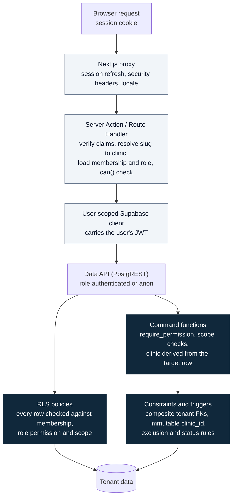

# SmartClinic — Security Model: Tenant Isolation

| | |
| --- | --- |
| Status | **Draft for review** (system modeling phase). This version covers tenant isolation and authorization. Transport, headers, secrets and incident response are added in Phase 7 |
| Date | 2026-11-10 |
| Related | [RBAC_PERMISSION_MATRIX.md](RBAC_PERMISSION_MATRIX.md) · [PHASE_0_REPOSITORY_AUDIT.md](PHASE_0_REPOSITORY_AUDIT.md) §10 (controls S1–S15) |

**Threat assumption.** Every signed-in user, patient or staff, can call the Supabase Data API, Realtime and Storage directly with their own JWT, bypassing the SmartClinic UI. Isolation must therefore hold **inside PostgreSQL**, whatever request reaches it.

---

## 1. Isolation layers



- **Authoritative layers (dark):** RLS, command functions, constraints and triggers.
- **Usability layers (light):** they give early, localized errors and defense in depth.
- **A direct call with a JWT skips the three light layers** and lands straight on the Data API.

| Layer | Isolation mechanism |
| --- | --- |
| Identity | Supabase Auth JWT. The server verifies claims (`getUser`/`getClaims`) and never trusts `getSession()` alone |
| Tenant context | The clinic comes from the URL slug and is resolved on the server, **never** from a request body. Commands derive `clinic_id` from the target row when there is one, or check the passed value against membership |
| Rows | `clinic_id` on every tenant table. RLS calls `private` helpers. Composite foreign keys make cross-clinic references impossible |
| Columns | RLS works per row. When a role may see only some columns (accountant, patient), it gets **no row access** to the table and uses a narrow `SECURITY DEFINER` function instead |
| Realtime | Private channels, authorized by RLS on `realtime.messages` |
| Storage | Object paths start with `<clinic_id>/`, storage policies use the same helpers, and URLs are short-lived signed URLs |
| Jobs and webhooks | Privileged client in server-only code. Each item is processed with its own `clinic_id` filter. Callers are authenticated by HMAC or provider signature |
| Platform | A separate path (`platform_admins` + `aal2`) with its own functions and no grant on patient-level tables |

---

## 2. Principals inside PostgreSQL

| Database role | Who | Table access |
| --- | --- | --- |
| `anon` | Public booking pages | **No table grant.** Only the rate-limited `public_*` functions (clinic profile, bookable services and doctors, slots) |
| `authenticated`: staff member | JWT of a user with an active membership | SELECT under RLS; DML on managed tables under RLS; EXECUTE on command functions |
| `authenticated`: patient account | JWT of a phone-OTP user | **No access to tenant-table rows**, because the policies require a membership patients do not have. EXECUTE on `portal_*` functions only |
| `authenticated`: platform admin | JWT + `platform_admins` row + `aal2` | No access to tenant rows through clinic policies. EXECUTE on `platform_*` functions only |
| `service_role` | Worker, webhooks, migrations | Bypasses RLS. Used only in the server-only code paths listed and reviewed in §6 |

One person can be several principals at once, for example a receptionist who is also a patient of the same clinic. Each path checks its own principal: portal functions read `patient_accounts`, and workspace queries read `clinic_members`.

---

## 3. RLS helper functions

All helpers share these properties:
- `STABLE`, `SECURITY DEFINER`, `SET search_path = ''`;
- stored in the `private` schema, which the Data API does not expose;
- called as `(select private.fn(...))`, so PostgreSQL evaluates each one once per statement.

| Helper | Role |
| --- | --- |
| `private.active_clinic_ids()` | Clinics where `auth.uid()` has an active membership and the clinic is not closed |
| `private.has_permission(clinic_id, permission)` | True if the caller's role in that clinic grants the permission (join on `role_permissions`) and the session reaches the `aal` level the role requires |
| `private.is_practitioner_only(clinic_id)` | True if the caller's role is `doctor` (scope limited to their own data) |
| `private.current_doctor_ids(clinic_id)` | The `doctors.id` linked to `auth.uid()` in that clinic (practitioner scope) |
| `private.require_permission(clinic_id, permission)` | Raises `FORBIDDEN` (42501) without the permission. It is the first statement of every command |
| `private.require_platform_admin()` | Raises unless the caller is an active platform admin with an `aal2` session |
| `private.portal_patient_ids()` | Patient records linked to `auth.uid()` through active `patient_accounts` rows |

Because these helpers are `SECURITY DEFINER`, the policies on `clinic_members` never call themselves recursively.

---

## 4. Policy templates by table category

| Category | Tables | SELECT | INSERT / UPDATE / DELETE |
| --- | --- | --- | --- |
| **Public reference** | `specialties`, active public `subscription_plans` | Everyone | Platform functions only |
| **Tenant managed** | `services`, `doctors`, `doctor_services`, `doctor_schedules`, `doctor_availability`, `doctor_time_off`, `clinic_closures`, `clinic_settings`, `patients` | `has_permission(clinic_id, '<x>.view')` + scope clause if needed | `has_permission(clinic_id, '<x>.manage')`, a `WITH CHECK` on the same clause, plus a scope clause (e.g. the doctor's own schedule) |
| **Tenant command** | `appointments`, `doctor_sessions`, `queue_entries`, `invoices`, `invoice_items`, `payments`, `clinic_members`, `clinic_invitations`, `patient_accounts`, `notifications`, `notification_attempts`, `queue_display_screens`, `data_subject_requests` | As above, with scope | **None** for `authenticated`. Command functions only |
| **Append-only logs** | `audit_logs`, `appointment_history`, `queue_events`, `patient_consents`, `legal_acceptances`, `domain_events` | Restricted (e.g. `audit.view`) | INSERT through triggers and definer functions only. UPDATE and DELETE revoked from **every** role except migrations |
| **User-owned** | `user_profiles` | `id = auth.uid()` (colleagues' names through a definer function) | Own row only |
| **Platform** | `platform_admins`, `subscriptions`, `subscription_features`, `legal_documents`, `permissions`, `role_permissions` | The owner reads their own clinic's subscription. Everything else through functions | Platform functions or migrations only |
| **Internal** | `private.*`, `clinic_counters`, `consultation_duration_stats` | Not exposed through the Data API (stats are read through query functions) | Definer functions and jobs |

### 4.1 Example (illustrative, not a migration yet)

```sql
-- appointments: staff read access, doctors limited to their own data
create policy appointments_select on public.appointments
for select to authenticated
using (
  (select private.has_permission(clinic_id, 'appointments.view'))
  and (
    not (select private.is_practitioner_only(clinic_id))
    or doctor_id in (select private.current_doctor_ids(clinic_id))
  )
);
-- no insert/update/delete policy: writes go through command functions only
revoke insert, update, delete on public.appointments from authenticated, anon;
```

**Doctor scope:**
- A member with the `doctor` role sees only rows for their linked doctor ids.
- On `patients`, the same clause becomes an `exists` over appointments with those doctor ids.
- Owners and admins who also have a `doctors` row keep visibility over the whole clinic.

---

## 5. Realtime, storage and display isolation

| Surface | Rule |
| --- | --- |
| Realtime topics | **`clinic:<clinic_id>:board:<date>`** requires `queue.view` in that clinic.<br>**`clinic:<clinic_id>:doctor:<doctor_id>:<date>`** requires `queue.view`, and for a practitioner-only member also a doctor id in `current_doctor_ids`.<br>A policy on `realtime.messages` parses `realtime.topic()` and calls the helpers |
| Realtime payloads | Ids and versions only, so even a wrongly authorized subscriber learns nothing about patients |
| Storage | Bucket `clinic-private`, path `<clinic_id>/<kind>/<uuid>.<ext>`. Policies check `has_permission(split_part(name,'/',1)::uuid, ...)`. Invoice PDFs are generated on demand and served through 60-second signed URLs |
| Display screens | Token of at least 128 bits, stored hashed. The endpoint returns ticket numbers and doctor display names for one clinic. The token can be revoked, and `last_seen_at` is tracked |
| Patient links | Booking uses the clinic slug. Manage and cancel links use opaque, expiring tokens, never ids in a query string |

---

## 6. Privileged code paths (service role)

The service-role key bypasses RLS, so each use is listed here and reviewed.

| Path | Why the privilege | Required safeguards |
| --- | --- | --- |
| `/api/internal/jobs/*` (dispatch, planning) | Processes events for every clinic | HMAC-verified caller. Each item filtered by its `clinic_id`. Bounded batches. `actor_type = system` |
| `/api/webhooks/<provider>` | Delivery receipts | Provider signature verified. Lookup by `provider_message_id` only. Idempotent |
| Platform module infrastructure | Clinic approval, subscriptions | Prefer `platform_*` definer functions called with the user's JWT (aal2). Service role only where the Auth admin APIs require it |
| Migrations and seeds | Schema changes | CI only, after review |

ESLint restricts imports of the privileged client to these folders, and a CI test searches for the service-role variable everywhere else.

---

## 7. Threats and mitigations

| Threat | Example | Mitigation |
| --- | --- | --- |
| Cross-tenant IDOR | `GET /rest/v1/patients?id=eq.<other clinic's id>` | RLS returns no row. The UI shows `NOT_FOUND`, never "forbidden", so existence is not revealed |
| Spoofed `clinic_id` on write | Inserting a service with another clinic's id | `WITH CHECK has_permission(clinic_id, …)` fails |
| Cross-tenant reference | An appointment in clinic A pointing to a patient of clinic B | Composite FK `(clinic_id, patient_id)` rejects it |
| Moving a row to another tenant | `update services set clinic_id = …` | Trigger: `clinic_id` is immutable (BR-T-01) |
| Stale authorization | A removed receptionist keeps a valid JWT for up to an hour | Membership and status are read on **every** query, and the JWT carries no role |
| Privilege escalation | An admin promotes themself to owner | The command forbids self-changes and owner or admin grants by an admin (BR-T-05) |
| Bypassing business rules | Direct `update appointments set status = 'completed'` | No DML grant on command tables. Transitions happen only in commands |
| `SECURITY DEFINER` misuse | A function forgets its permission check | `require_permission` mandatory as the first statement, verified by a test. `search_path = ''`. EXECUTE revoked from `public` and granted per role |
| A view bypassing RLS | A view owned by `postgres` exposes rows | Every view is `security_invoker = true`. A test rejects any `public` view without it |
| Embedded resources | `select=*,appointments(*)` leaks related rows | RLS also applies to embedded tables. Tested |
| Enumeration by counting or errors | `count=exact`, or different errors for "exists" and "not yours" | The same `NOT_FOUND` in both cases. No exact counts on patient tables for scoped roles |
| Realtime eavesdropping | Subscribing to another clinic's topic | Private channels + RLS on `realtime.messages`. Payloads without data |
| Guessing storage paths | Fetching `<other clinic>/invoices/…` | Storage policies by path prefix. Signed URLs only |
| Patient account overreach | A shared family phone sees other people's records | Only explicitly linked records (BR-D-02), minimal portal fields, no automatic phone matching |
| Platform admin browsing | A super admin lists patients | No grant or policy for platform principals on patient-level tables. Aggregate functions only |
| Leaked service-role key | Key committed or exposed client-side | Server-only module, ESLint rule, environment schema that rejects `NEXT_PUBLIC_` secrets, gitleaks in CI, rotation procedure |

---

## 8. Isolation test matrix (from Phase 3)

For **every** tenant table, the Vitest suites in `tests/db/` run each operation as each principal. They connect to the local database and impersonate API roles exactly like PostgREST does (`SET LOCAL ROLE` + `request.jwt.claims`). pgTAP was replaced by this approach during Phase 3 (IMP-01 in [DATABASE_SCHEMA.md](DATABASE_SCHEMA.md)).

| Principal | Expected result |
| --- | --- |
| Member of the same clinic, each role | What the permission matrix states, including scope |
| Member of **another** clinic | 0 rows on SELECT. Error on INSERT / UPDATE / DELETE and on commands |
| Suspended or removed member | Same as another clinic |
| Patient account (linked and unlinked) | 0 rows from tables. Portal functions return only linked records |
| Platform admin | 0 rows from patient-level tables |
| `anon` | 0 rows. Public functions return public fields only |

**Meta-tests:**
- every table in `public` has RLS enabled;
- every `SECURITY DEFINER` function sets `search_path` and calls a `require_*` guard;
- every view is `security_invoker`;
- `anon` has no table grant.
