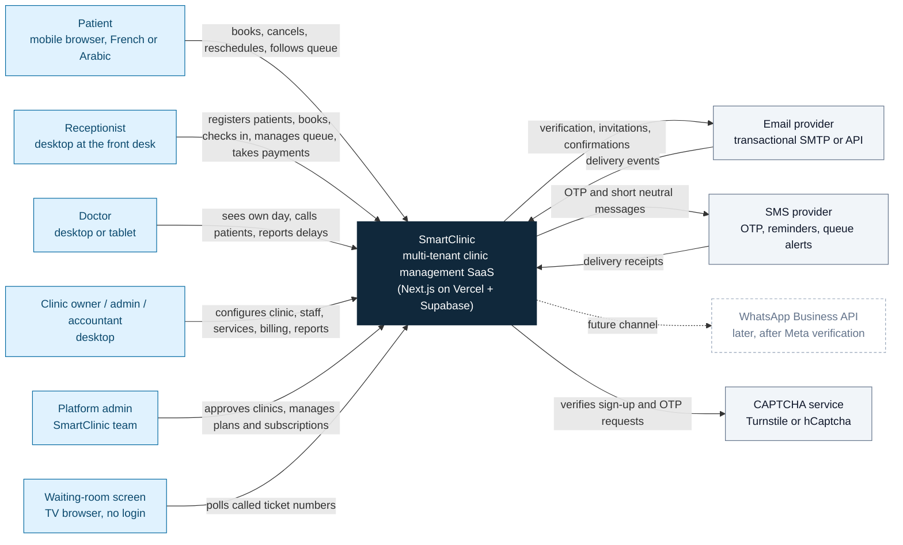
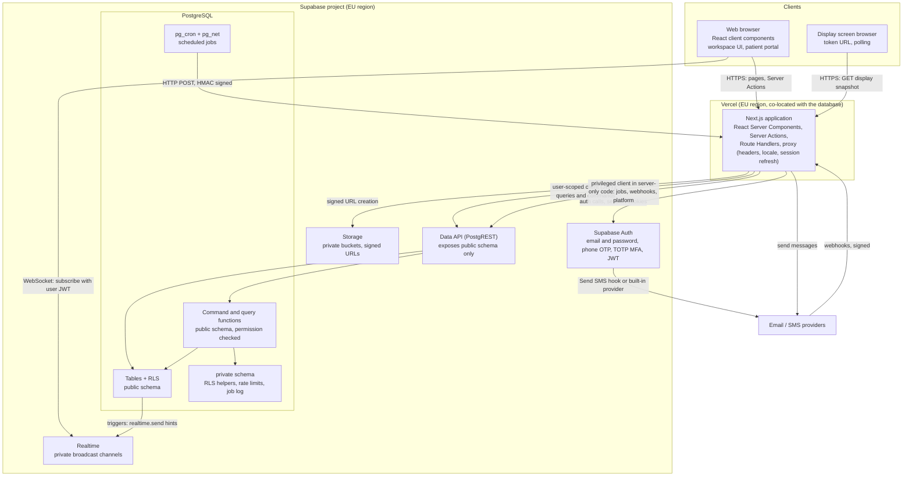
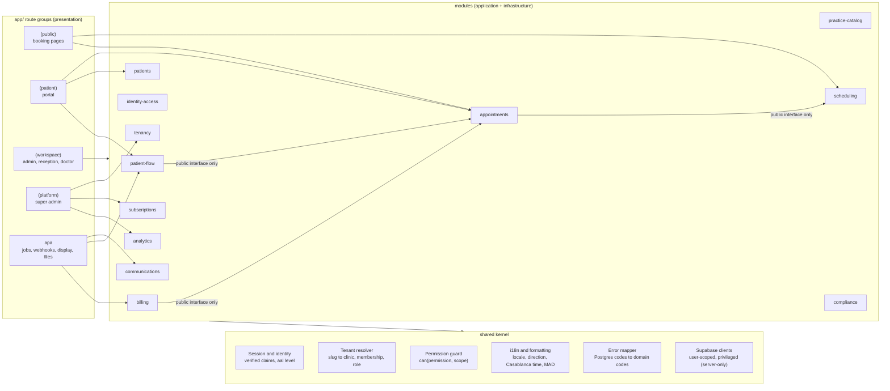
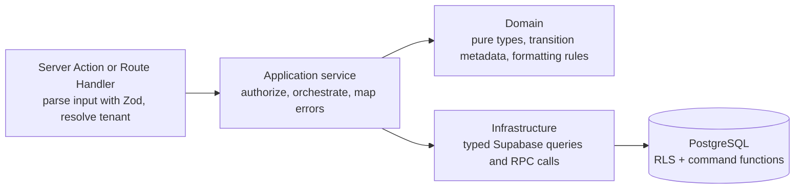
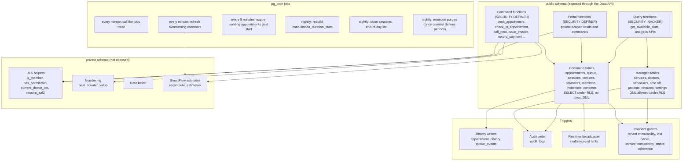

# SmartClinic — System Architecture

| | |
| --- | --- |
| Status | **Draft for review** (system modeling phase) |
| Date | 2026-11-10 |
| Related | [PHASE_0_REPOSITORY_AUDIT.md](PHASE_0_REPOSITORY_AUDIT.md) §8 · [SECURITY_MODEL.md](SECURITY_MODEL.md) · [API_SPECIFICATION.md](API_SPECIFICATION.md) |

These diagrams follow the C4 levels (context → containers → components) and are drawn as Mermaid flowcharts.

---

## 1. System context

**Outside the system boundary on purpose:** insurers (AMO/CNSS/CNOPS), laboratories, electronic medical records, payment gateways and any AI service. None of them is in the MVP.

---

## 2. Containers

| Container | Technology | Responsibility | Notes |
| --- | --- | --- | --- |
| Next.js application | Next.js App Router, React, TypeScript strict, Tailwind, shadcn/ui, next-intl | All user interfaces; application services; jobs and webhook endpoints | One deployment, five workspaces as route groups |
| Supabase Auth | GoTrue | Identities, sessions, MFA, OTP | Staff: email + password (+ TOTP). Patients: phone OTP |
| Data API | PostgREST | The only way into PostgreSQL from the application | Reachable directly by any signed-in user with their JWT, so **RLS and command checks must assume hostile callers** |
| PostgreSQL | Postgres 15+ (Supabase) | Data, invariants, RLS, commands, triggers, jobs | The real security and consistency boundary |
| Realtime | Supabase Realtime | Staff screen updates | Hints only, private channels |
| Storage | Supabase Storage | Clinic logos, invoice and receipt PDFs | No patient documents in the MVP |

---

## 3. Components — Next.js application

**Module rules** (enforced by ESLint `no-restricted-imports`)
- A module imports another module only through its `index.ts`.
- `domain/` has no I/O imports.
- The privileged Supabase client may be imported only from `app/api/**` jobs and webhooks and from the platform module's infrastructure.
- Components in `app/` never import `infrastructure/` directly. They call Server Actions exported by modules.

### 3.1 Inside one module

---

## 4. Components — PostgreSQL

---

## 5. Key runtime decisions

### 5.1 Reads and writes
- **Reads:** Server Components query through the user-scoped client, so RLS applies. Pagination is keyset-based. Large lists never use `count=exact`.
- **Writes:**
  - managed tables: direct DML under RLS;
  - command tables: command functions only.
  - Both are always called from Server Actions, never from client components.
- **Concurrency:**
  - optimistic, through `version` columns, for user edits;
  - pessimistic, with row locks inside commands, for sessions, counters and invoices.

### 5.2 Realtime
- **Staff screens** subscribe to private broadcast topics:
  - `clinic:<clinic_id>:board:<date>`, the reception day board;
  - `clinic:<clinic_id>:doctor:<doctor_id>:<date>`, the doctor console.
- Payload: `{ "entity": "queue", "session_id": …, "version": n }`. Clients refetch when the version increases. They also poll every 30 s as a safety net.
- **Patient portal** polls its own entry's position and estimate every 30 s through a portal function. It has no realtime subscription in the MVP, so there are no patient-facing channels to secure.
- **Display screens** poll `GET /api/display/<token>` every 10 s. The response is ticket numbers only.

### 5.3 Background jobs
- **pg_cron schedules everything.** For work that needs provider APIs, `pg_net` POSTs a signed request to `/api/internal/jobs/*` on the Next.js app.
- This needs no Vercel cron (plan-limited) and keeps all job code in the same TypeScript modules.
- Each job run handles a bounded batch (at most 100 items) to stay within function time limits.
- Pure-SQL jobs (estimate refresh, pending expiry, stats, session close) run directly in PostgreSQL.

### 5.4 Estimator placement
The v1 estimator runs **in PostgreSQL** (`private.recompute_estimates`), inside every queue command. Estimates are therefore always consistent with the queue state that the same transaction commits. This supersedes audit §8.3, which placed the estimator in TypeScript (decision MD-13).

### 5.5 Environments

| Environment | Supabase | Vercel | Data |
| --- | --- | --- | --- |
| Local | Supabase CLI stack (`supabase start -x` with unused services excluded) | `next dev` | Seed fixtures only |
| Staging | Separate project, same region as prod | Preview / staging deployment | Synthetic data only |
| Production | Separate project, paid tier + PITR | Production deployment, Pro plan | Real data only after CNDP clearance |

Migrations reach staging and production only through CI, after review. The service-role key exists only in Vercel's server environment and in CI secrets.
