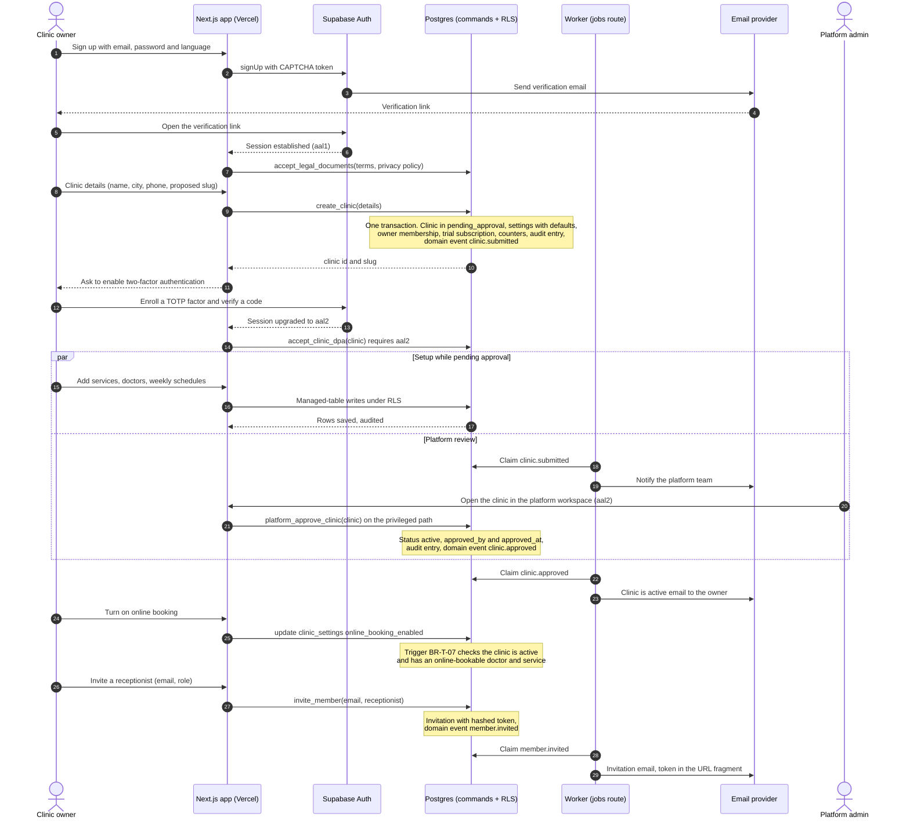
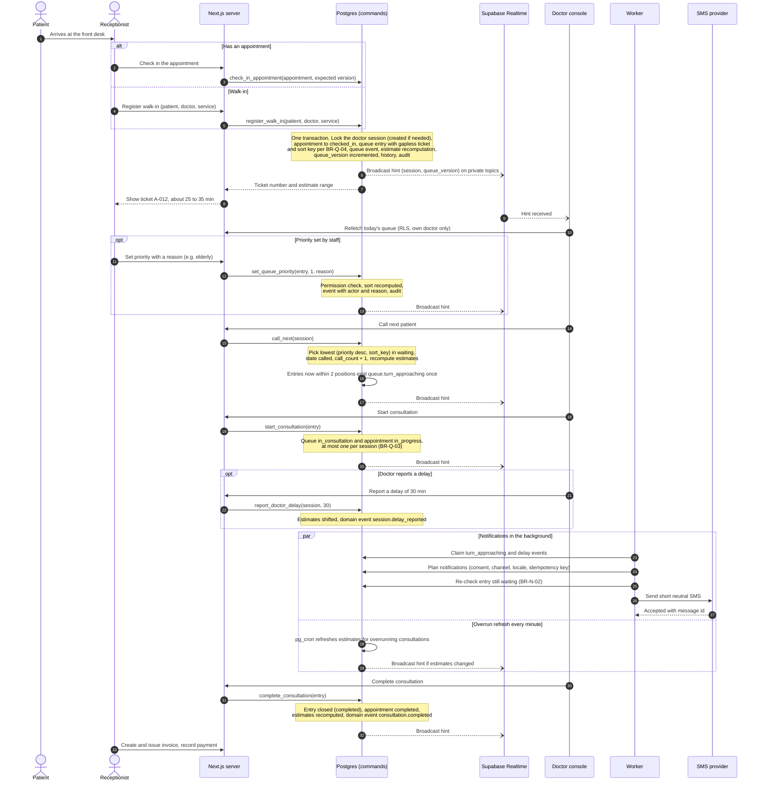
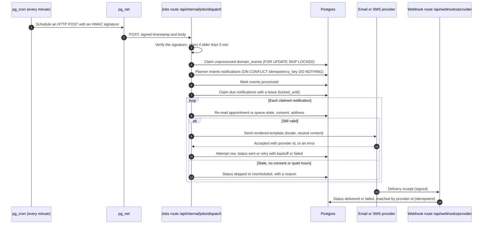

# SmartClinic — User Workflows

| | |
| --- | --- |
| Status | **Draft for review** (system modeling phase) |
| Date | 2026-11-10 |
| Related | [BUSINESS_RULES.md](BUSINESS_RULES.md) (rule ids referenced below) · [API_SPECIFICATION.md](API_SPECIFICATION.md) (commands) |

This document has four diagrams:
1. The patient journey (activity diagram).
2. Clinic onboarding (sequence).
3. Queue management (sequence).
4. Notification dispatch (sequence). The queue flow depends on it.

---

## 1. Patient journey — activity diagram

The colors show who acts: **patient**, **system**, **reception**, **doctor**.

```mermaid
flowchart TD
    S((Start)):::patient --> A[Opens the clinic booking link or scans its QR code]:::patient
    W0((Walk-in)):::patient --> WR[Reception finds or creates the patient record]:::reception
    WR --> WA[Walk-in appointment created directly in checked_in]:::system
    WA --> TK

    A --> B[Chooses a service and a doctor]:::patient
    B --> C[System computes available slots on the server]:::system
    C --> D{Any slot that suits?}
    D -- No --> B
    D -- Yes --> E[Selects a slot and enters a phone number]:::patient
    E --> F[OTP sent by SMS]:::system
    F --> G{OTP valid?}
    G -- "No, attempts left" --> E
    G -- "No, limit reached" --> X1[Blocked temporarily, rate limit]:::system
    G -- Yes --> H{Who is the appointment for?}
    H -- "A person already linked to this account" --> J
    H -- "Myself or a dependent, first time" --> I[Enters minimal details and consents]:::patient
    I --> J[Confirms the booking]:::patient
    J --> K[book_appointment, one transaction]:::system
    K --> L{Slot still free and rules met?}
    L -- No --> C
    L -- Yes --> M{Clinic auto-confirms online bookings?}
    M -- Yes --> N[Status confirmed, confirmation message sent]:::system
    M -- No --> O[Status pending, booking received message sent]:::system
    O --> P{Reception confirms before the start time?}
    P -- Yes --> N
    P -- "Declines or time passes" --> X2[Cancelled, patient informed]:::system

    N --> Q[Reminder sent 24 h before, status re-checked first]:::system
    Q --> R{Patient still coming?}
    R -- "No, cancels before cutoff" --> X3[Cancelled from the portal]:::patient
    R -- "Wants another time" --> C
    R -- Yes --> T{Arrives on the day?}
    T -- No --> NS[Reception marks no-show after the grace period]:::reception
    T -- Yes --> U[Reception checks the patient in]:::reception
    U --> TK[Ticket number and estimated wait range shown]:::system
    TK --> V[Waits and can follow the queue position on a phone]:::patient
    V --> V2{Two or fewer patients ahead?}
    V2 -- Yes --> V3[Turn approaching message, sent once]:::system
    V2 -- No --> V
    V3 --> Y[Doctor calls the ticket]:::doctor
    Y --> Y2{Patient present?}
    Y2 -- "No, recall later" --> V
    Y2 -- "Left the clinic" --> X4[Closed as left before consultation]:::reception
    Y2 -- Yes --> Z[Consultation in progress]:::doctor
    Z --> ZC[Doctor completes the consultation]:::doctor
    ZC --> INV[Invoice issued and payment recorded]:::reception
    INV --> RC[Receipt given or sent]:::system
    RC --> E1((End)):::patient
    NS --> E1
    X2 --> E1
    X3 --> E1
    X4 --> E1

    classDef patient fill:#e0f2fe,stroke:#0369a1,color:#0c4a6e
    classDef system fill:#f1f5f9,stroke:#475569,color:#0f172a
    classDef reception fill:#ccfbf1,stroke:#0f766e,color:#134e4a
    classDef doctor fill:#fef3c7,stroke:#b45309,color:#78350f
```

**Notes**
- **Slot lists come from the server** (BR-B-04…08). A slot shown to the patient can still be taken by someone else before confirmation, which is why step K re-checks it atomically.
- **Linking a person to an account (step H)** never happens by matching phone numbers (BR-D-02). A "first time" booking creates a new patient record linked to the account. Reception merges duplicates later.
- **The portal shows queue position and estimate by polling**, not through realtime ([SYSTEM_ARCHITECTURE.md](SYSTEM_ARCHITECTURE.md) §5.2). It never shows other patients.
- **Patients without a smartphone** follow the same path from "Reception checks the patient in" onwards. Their booking is made by reception over the phone, starting in `confirmed`.

---

## 2. Clinic onboarding — sequence diagram

**Decisions shown**
- **Auth and staff emails.** Email verification and password reset use Supabase Auth's mailer, configured to use the same SMTP provider. Every other email goes through the SmartClinic worker, so it can be localized and tracked.
- **Approval does not block setup.** Patients can only book once the platform approves the clinic (BR-P-02).
- **MFA is required** before the owner accepts the data processing agreement and before any platform action (BR-T-06).

---

## 3. Queue management — sequence diagram

**Concurrency notes**
- **Commands lock the `doctor_sessions` row (`SELECT … FOR UPDATE`) first.** Two receptionists checking in at the same moment are serialized and get consecutive tickets.
- **Commands that act on a specific appointment pass the `version` the user saw.** A mismatch returns `STALE_STATE`, and the UI refetches.
- **Realtime messages are hints** with no patient data. Each client refetches through RLS, so a missed hint only delays an update and the next hint or a 30-second poll fixes it.

---

## 4. Notification dispatch — sequence diagram

A crashed worker leaves leases that expire. The next run picks those notifications up again. Duplicate sends are prevented by the idempotency key, plus the check that status is still `processing` when the result is recorded.
